# Guía Junior — WAItt, de cero a tu primer cambio

Esta guía es para quien hereda WAItt y necesita entenderlo sin perderse en el código. Explica el recorrido completo de una simulación, los archivos que importan y cómo hacer cambios pequeños sin romper el resto.

No sustituye a la [Guía Técnica](guia-tecnica.md), que es la referencia detallada. Esta guía es el mapa para empezar.

## Cómo usar esta guía

Ruta recomendada:

1. Lee las secciones 1 a 5 para construir el modelo mental.
2. Arranca el proyecto y completa el smoke test de la sección 4.
3. Sigue un tick completo con la sección 5 y el ejercicio 1.
4. Lee las secciones 6 a 11 según el área que vayas a tocar.
5. Haz las recetas y ejercicios en orden. Cada uno tiene criterio de aceptación.
6. Antes de abrir un PR, usa la checklist de la sección 16.

## 1. La idea en 60 segundos

WAItt es un **simulador de monitoreo térmico**. No hay hardware ni Arduino. El backend crea servidores simulados, llamados nodos, que se calientan, se enfrían, reciben tareas y pueden fallar.

Hay tres piezas:

| Pieza | Qué hace | Dónde vive |
|---|---|---|
| Backend | Simula, aplica reglas, atiende la API y emite WebSocket | `backend/` |
| Frontend | Muestra la escena 3D, el HUD, los paneles y el replay | `frontend/` |
| ML | Entrena un modelo y predice temperatura | `ml/` |

Opcionalmente hay una base de datos MariaDB para guardar telemetría y eventos.

```text
┌────────────────────┐        HTTP / WebSocket        ┌──────────────────────────────┐
│ Navegador          │<------------------------------>│ Backend Node.js/TypeScript   │
│ React + Three.js   │                                │ simulación + API + EventBus  │
└────────────────────┘                                └──────────────┬───────────────┘
                                                                     │
                                          JSON por stdin/stdout      │ SQL
                                     ┌───────────────────────────────┼──────────────────┐
                                     │                               │                  │
                              ┌──────▼──────┐                 ┌──────▼──────┐    ┌──────▼──────┐
                              │ ml.worker   │                 │ MariaDB     │    │ Log JSONL   │
                              │ Python      │                 │ telemetría  │    │ data/       │
                              └─────────────┘                 └─────────────┘    └─────────────┘
```

Lo importante: **el backend es la fuente de verdad**. El frontend no simula nada. Solo pinta lo que recibe y envía órdenes por HTTP.

## 2. Glosario mínimo

| Término | Significado |
|---|---|
| Nodo | Servidor simulado. Puede ser `general` o `worker`. |
| Servidor General | Nodo agregado. Representa la media de los workers. No recibe IA ni perturbaciones. |
| Worker | Nodo normal, como `node-1`, `node-2`, etc. |
| Tick | Paso periódico de la simulación. Por defecto cada 1000 ms. |
| `dtMs` | Tiempo real transcurrido desde el tick anterior, acotado a 5000 ms. |
| Tarea | Trabajo con prioridad, demanda de cómputo y duración. |
| Pool | Cola global de tareas pendientes. |
| Cola local | Cola de prioridad propia de cada nodo. |
| Pila LIFO | Historial de eventos del nodo; lo último entra arriba. |
| Regla | Condición reactiva que ejecuta una acción. |
| Evento | Perturbación o tráfico generado por el simulador o por API. |
| Inferencia | Predicción de temperatura a 15 s. |
| Control IA | Política que convierte predicciones en acciones sobre workers. |
| Telemetría | Muestra de temperatura y estado de un nodo. |
| Replay | Reproducción de los últimos 600 snapshots en el navegador. |

## 3. Mapa del repositorio

```text
TIA/
├─ backend/
│  ├─ src/
│  │  ├─ api/          routers Express, validación zod y AppContext
│  │  ├─ config/       configuración de MariaDB
│  │  ├─ domain/       lógica pura: nodos, térmico, tareas, reglas, eventos, IA
│  │  ├─ engine/       EventBus, SimulationEngine y EventEngine
│  │  ├─ infra/        HTTP, Socket.IO, logs, BD, persistencia, worker IA
│  │  ├─ config.ts     variables de entorno con defaults
│  │  └─ index.ts      composición y arranque
│  ├─ data/            default-rules.json (semilla de reglas)
│  ├─ test/            146 tests vitest
│  └─ README.md        API y detalles del backend
├─ frontend/
│  ├─ src/
│  │  ├─ components/   HUD, escena, dock, drawer, centro de control, eventos
│  │  ├─ hooks/        REST/WebSocket y estado del cliente
│  │  ├─ lib/          recomendación por nodo
│  │  └─ three/        escena Three.js, layout, tema y etiquetas
│  └─ src/**/*.test.js 11 tests node:test
├─ ml/
│  ├─ export.py        lee telemetría
│  ├─ features.py      features y target
│  ├─ model.py         split cronológico y GradientBoostingRegressor
│  ├─ metrics.py       MAE, RMSE y baseline
│  ├─ anomaly.py       umbral de residuos
│  ├─ ollama.py        explicación opcional
│  ├─ train.py         pipeline
│  ├─ predict.py       inferencia puntual
│  ├─ worker.py        worker JSON stdin/stdout
│  └─ tests/           18 tests pytest
├─ docker/mysql/init/01-schema.sql
├─ docs/
│  ├─ guia-usuario.md
│  ├─ guia-tecnica.md
│  ├─ guia-junior.md
│  └─ pruebas-calibracion.md
└─ docker-compose.yml
```

### 3.1 ¿Dónde toco si quiero cambiar X?

| Quiero cambiar… | Empieza por… | Después revisa… |
|---|---|---|
| La física térmica | `backend/src/domain/thermal.ts` | `node.ts`, `test/thermal*.test.ts`, reentrenar ML |
| Un estado o campo del nodo | `backend/src/domain/node.ts` y `types.ts` | API, `TimeSeriesSink`, ML, frontend |
| La prioridad o el dispatcher | `backend/src/domain/tasks.ts` y `dispatcher.ts` | `test/tasks.test.ts`, `test/dispatch.test.ts` |
| Una regla nueva | `backend/data/default-rules.json` o `POST /api/rules` | `test/rules.test.ts`, panel de reglas |
| Una acción de regla | `backend/src/domain/actions.ts` | `types.ts`, `validation.ts`, tests |
| Un evento nuevo | `backend/src/domain/events.ts` | `config.ts`, `.env.example`, `EventEngine`, tests |
| Una acción de IA | `backend/src/domain/aiControl.ts` | `inferenceController.ts`, `ai.routes.ts`, tests |
| Una tabla o columna | `docker/mysql/init/01-schema.sql` | `TimeSeriesSink`, `ml/features.py` |
| Una feature de ML | `ml/features.py` | `ml/worker.py`, `InferenceService`, reentrenar |
| Un panel de UI | `frontend/src/components/` | `App.jsx`, `App.css`, `ControlCenter.jsx` |
| Un hook de datos | `frontend/src/hooks/` | `App.jsx` y el componente que lo consume |

## 4. Primer arranque sin sorpresas

### 4.1 Requisitos

- Node.js 20 o superior.
- `pnpm` para el backend.
- `npm` para el frontend.
- Docker Desktop, solo si quieres MariaDB.
- Python 3.14 y `ml/.venv`, solo si quieres inferencia o entrenamiento.

En Windows, usa siempre `pnpm.cmd` y `npm.cmd`. Los shims de PowerShell pueden estar bloqueados por la policy de ejecución.

### 4.2 La regla de puertos

El backend escucha en `PORT`. El proxy de Vite debe apuntar al mismo puerto. Con la configuración por defecto, ambos usan `3000`; el frontend sigue en `5173`.

| Pieza | Dónde se configura | Valor por defecto |
|---|---|---|
| Backend | `PORT` en `backend/.env` | `3000` |
| Proxy Vite | `frontend/vite.config.js` | `http://localhost:3000` |
| CORS | `CORS_ORIGIN` en `backend/.env` | `http://localhost:5173` |
| Frontend | Vite | `5173` |

Regla mental:

```text
PORT del backend == target de /api y /socket.io en frontend/vite.config.js
```

Si no coinciden, Vite muestra:

```text
[vite] http proxy error: /api/system
AggregateError [ECONNREFUSED]
```

Si necesitas otro puerto, cambia `PORT` y actualiza los dos targets del proxy en el mismo paso. No mezcles backend y proxy en puertos distintos. Tampoco cambies el puerto del frontend sin actualizar `CORS_ORIGIN`.

### 4.3 Arranque

Terminal 1:

```powershell
cd backend
pnpm.cmd install
pnpm.cmd dev
```

Debe aparecer algo parecido a:

```text
Backend WAItt escuchando en http://localhost:3000 (CORS: http://localhost:5173)
Simulación iniciada (tick cada 1000 ms)
```

Terminal 2:

```powershell
cd frontend
npm.cmd install
npm.cmd run dev
```

Abre `http://localhost:5173`.

Terminal 3, opcional:

```powershell
docker compose up -d
```

MariaDB queda en `localhost:3306` y phpMyAdmin en `http://localhost:8080`.

### 4.4 Smoke test

Antes de tocar código, comprueba que el sistema está vivo:

```powershell
curl.exe http://localhost:3000/health
curl.exe http://localhost:3000/api/nodes
curl.exe http://localhost:3000/api/system
curl.exe http://localhost:3000/api/events
```

Checklist:

- `/health` devuelve `status: "ok"` y `running: true`.
- `/api/nodes` devuelve el general y los workers.
- `/api/system` devuelve `summary` y `pendingQueue`.
- La escena 3D muestra racks y el HUD dice **en vivo**.
- Al seleccionar un nodo, el drawer muestra temperatura, cola y pila.

### 4.5 Si no arranca

| Síntoma | Causa probable | Qué hacer |
|---|---|---|
| `ECONNREFUSED` en Vite | Proxy a puerto sin backend | Iguala `PORT` y `vite.config.js` |
| Error de CORS | `CORS_ORIGIN` no coincide | Pon el origen exacto del frontend |
| `EADDRINUSE` | Puerto ocupado | `Get-NetTCPConnection -LocalPort 3000 -State Listen` |
| `IA n/a` | Falta `ml/out/model.joblib` | Entrena o desactiva inferencia |
| BD vacía | MariaDB caída o `DB_ENABLED=false` | `docker compose up -d` |
| Sin logs en consola | `LOG_CONSOLE=false` | Revisa `backend/.env` |

## 5. El tick: el corazón del sistema

`SimulationEngine` usa `setInterval` con `TICK_MS`. En cada vuelta calcula el tiempo real transcurrido:

```ts
const now = Date.now()
const dt = Math.min(now - this.lastTickAt, MAX_DT_MS)
```

`MAX_DT_MS` es 5000. Esto evita saltos enormes si el proceso se congela.

### 5.1 Orden exacto

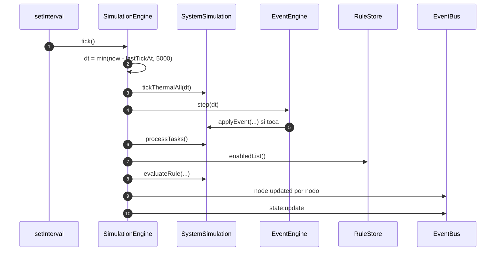

En pseudocódigo:

```text
1. Avanzar temperatura de todos los nodos.
2. Evaluar el generador de eventos.
3. Registrar telemetría cada N ticks, si está configurado.
4. Completar tareas vencidas y repartir el pool.
5. Arrancar la siguiente tarea local de cada nodo libre.
6. Evaluar reglas habilitadas.
7. Actualizar updatedAt y emitir node:updated.
8. Emitir state:update con el snapshot completo.
```

### 5.2 Por qué importa el orden

- Los eventos se aplican **después** del térmico y **antes** de las tareas. Un `task_arrival` puede despacharse en el mismo tick.
- Las reglas se evalúan **después** de procesar tareas, así ven el estado más reciente.
- `state:update` se emite una vez por tick, al final.
- `node:updated` se emite por cada nodo antes del snapshot. `TimeSeriesSink` lo usa para telemetría.

### 5.3 Tres reglas de oro

1. **No bloquees el tick.** Nada de esperas largas, bucles infinitos ni I/O síncrono dentro de `step`.
2. **El dominio no hace I/O.** `domain/` no conoce Express, Socket.IO ni MariaDB.
3. **La API valida y traduce.** La física y las reglas viven en `domain/`.

### 5.4 Pausa, reanudación y paso manual

- `POST /api/sim/pause` detiene el `setInterval`.
- `POST /api/sim/resume` lo vuelve a arrancar y reinicia `lastTickAt`.
- `POST /api/sim/tick` ejecuta un tick manual. Devuelve `409` si la simulación está corriendo.
- `POST /api/sim/reset` reinicia nodos, contadores de reglas y runtime de eventos.

## 6. Dominio: nodos, tareas y pilas

### 6.1 Nodo

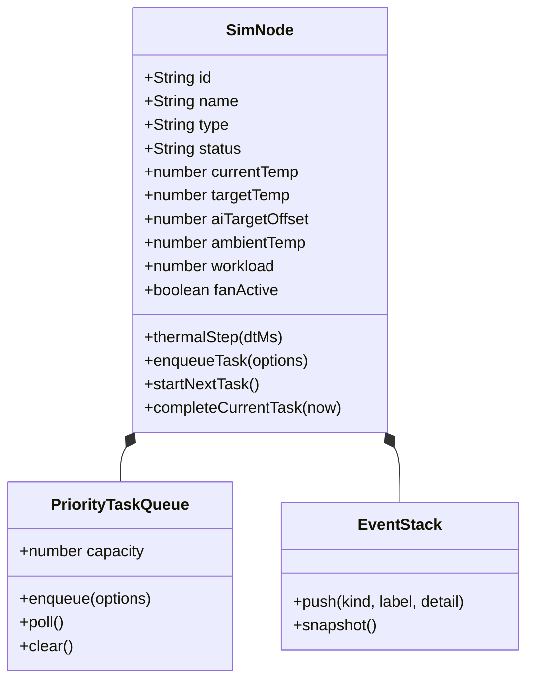

Estados del nodo:

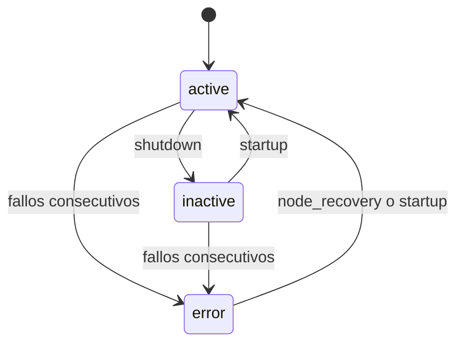

| Estado | Efecto térmico | ¿Recibe tareas del pool? |
|---|---|---|
| `active` | Converge al objetivo | Sí |
| `inactive` | Disipa hacia el ambiente | No |
| `error` | No se considera sano | No |

El Servidor General es un caso especial:

- Su temperatura es la media de los workers mientras está activo.
- No recibe tareas del pool.
- Puede procesar tareas encoladas por API o por una regla con `subject=system`.
- No admite eventos de perturbación.

### 6.2 Modelo térmico

```text
temp += ((target - temp) / 20
         + 0.35 * workload
         + taskHeat
         - 0.002 * (temp - ambient) * fanMultiplier) * dt
```

| Constante | Valor | Qué hace |
|---|---:|---|
| `timeConstantMs` | 20 000 | Inercia hacia el objetivo |
| `loadHeatGain` | 0.35 | Calor por unidad de carga |
| `dissipationRate` | 0.002 | Disipación hacia el ambiente |
| `fanDissipationMultiplier` | 3 | Multiplicador del ventilador |
| `COMPUTE_DEMAND_HEAT` | 0.07 | Calor por unidad de demanda |
| `COOLDOWN_TASK_COOLING` | 0.07 | Enfriamiento por unidad en `cooldown` |
| `INACTIVE_COOLING_TIME_MS` | 60 000 | Constante de un nodo apagado |

Con `workload=0`, el equilibrio ronda **29.62 °C** para objetivo 30 °C. Con `workload=0.3`, ronda **31.63 °C**. El objetivo no es el punto de equilibrio exacto: la carga y la disipación lo desplazan. Es una propiedad del modelo, no un bug.

### 6.3 Ciclo de vida de una tarea

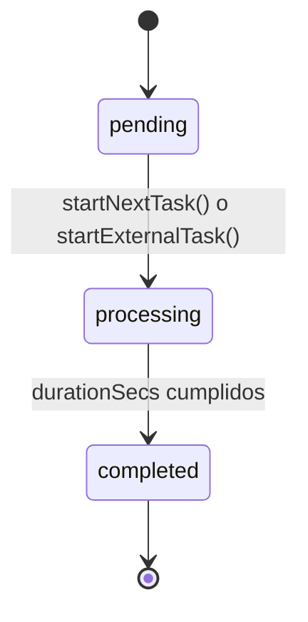

Campos:

| Campo | Rango | Default | Efecto |
|---|---:|---:|---|
| `priority` | 1–5 | 3 | 5 es la más urgente; empate FIFO |
| `computeDemand` | 1–5 | 1 | Calor extra `demanda × 0.07` |
| `durationSecs` | 1–10 | 5 | Duración canónica |
| `description` | 120 chars | — | Texto libre |
| `payload` | objeto | — | Datos de la tarea |

### 6.4 Cola local contra pool global

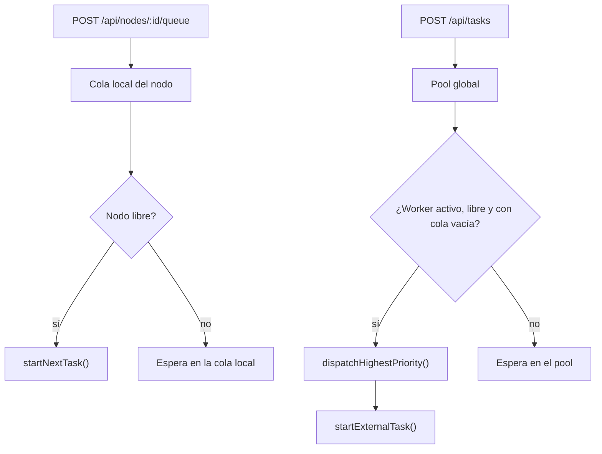

Detalle importante: el dispatcher elige al **worker activo libre más frío**. Un worker con cola local pendiente no es elegible. El general nunca recibe del pool.

Ejemplo visual:

```text
t=0s   pool: [p5 cooldown, p1 custom]
       node-1: 31.2 °C, libre
       node-2: 29.8 °C, libre
       node-3: 28.4 °C, tarea en curso

t=1s   dispatchHighestPriority()
       → tarea p5
       → node-3 no es elegible
       → node-2 es el más frío libre
       → node-2 empieza p5

t=1s   siguiente vuelta del while
       → tarea p1
       → node-1 es el más frío libre
       → node-1 empieza p1
```

Cada nodo procesa **una tarea a la vez**. El resto espera.

### 6.5 Pila LIFO

Cada nodo guarda hasta `STACK_CAPACITY` (20) entradas de tipo `event`, `task`, `rule`, `alert` o `change`. La última entrada es la más reciente. Se ve en el drawer y en la etiqueta 3D.

## 7. Reglas reactivas

Una regla tiene sujeto, condición, acción y cooldown.

```json
{
  "name": "Ventilador por temperatura alta",
  "enabled": true,
  "cooldownMs": 30000,
  "subject": "any",
  "metric": "temperature",
  "op": ">",
  "value": 55,
  "action": "fan_on",
  "actionParams": { "minutes": 2 }
}
```

### 7.1 Flujo de evaluación

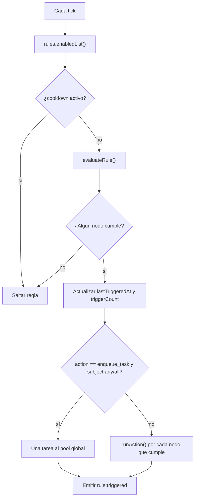

### 7.2 Sujetos

| Sujeto | Condición | Acción |
|---|---|---|
| `any` | Algún worker cumple | Se aplica a cada worker que cumple |
| `all` | Todos los workers cumplen | Se aplica a los que cumplen |
| `system` | El nodo general cumple | Se aplica al general |
| `node` | El nodo indicado cumple | Se aplica a ese nodo |

### 7.3 Métricas

| Métrica | Valor |
|---|---|
| `temperature` | Temperatura actual |
| `temperatureDelta` | `currentTemp - targetTemp` |
| `predictedTemperature` | Última predicción del nodo |
| `predictedDelta` | Predicción menos objetivo base |
| `workload` | Carga 0–1 |
| `status` | 0 activo, 1 inactivo, 2 error |
| `queueLength` | Tareas en cola local |
| `stackLength` | Entradas en la pila |

Las métricas predictivas usan la última inferencia. La predicción vale **60 s**. Sin predicción fresca o con `NaN`, la regla no dispara. `predictedDelta` usa `targetTemp` base, sin `aiTargetOffset`.

### 7.4 Reglas en caliente y semilla

`RuleStore` vive en memoria. Cada tick se lee `enabledList()`, así que crear, editar, activar o eliminar por API se aplica en vivo.

`RULES_FILE` (`backend/data/default-rules.json`) es una **semilla de solo lectura**. Al reiniciar se recargan las 7 reglas originales. Las reglas creadas por API se pierden.

Para que un cambio sobreviva a un reinicio, edita la semilla.

### 7.5 Ejemplo de disparo

```powershell
curl.exe -X POST http://localhost:3000/api/rules `
  -H "Content-Type: application/json" `
  -d '{"name":"Ventilador a 50C","metric":"temperature","op":">","value":50,"action":"fan_on","actionParams":{"minutes":1}}'
```

Después observa:

- Log del backend con tipo `rule`.
- Evento `rule:triggered` en la pestaña **Automatización**.
- Entrada `change` en la pila del nodo.
- Si `DB_ENABLED=true`, fila en `events` con `kind=rule`.

## 8. Eventos de simulación

Los eventos son ciudadanos de primera clase. Se definen en `backend/src/domain/events.ts`.

| Id | Categoría | Prob. default | Cooldown | Efecto |
|---|---|---:|---:|---|
| `task_arrival` | tráfico | 0.08 | 3 s | Encola 1–3 tareas en el pool o en un nodo |
| `thermal_spike` | perturbación | 0.02 | 15 s | Suma `magnitude` (6 °C) a un worker |
| `node_failure` | perturbación | 0.01 | 60 s | Fuerza `error` sin cancelar la tarea |
| `node_recovery` | perturbación | 0.03 | 30 s | Devuelve a `active` y limpia fallos |
| `fan_failure` | perturbación | 0.01 | 30 s | Apaga el ventilador |
| `workload_surge` | perturbación | 0.02 | 30 s | Suma carga, tope 1 |
| `synthetic_alert` | perturbación | 0.01 | 30 s | Emite una alerta sin cambiar temperatura |

### 8.1 Generador contra disparo manual

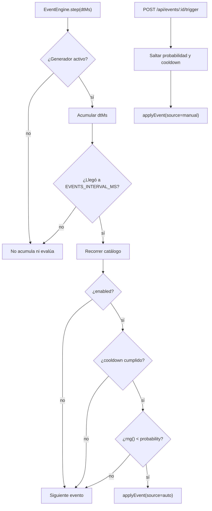

Reglas de aplicación:

- El disparo manual salta probabilidad y cooldown.
- El automático solo elige workers elegibles; nunca el general.
- Las perturbaciones que mutan estado rechazan el general con `400`.
- `task_arrival` con `nodeId` encola en la cola local; sin `nodeId`, en el pool.
- Cada disparo emite `event:triggered`, se registra como `event` y se persiste como `kind=sim_event`.
- `EVENTS_ENABLED=false` por defecto. El catálogo no se persiste; reiniciar restablece los valores.

### 8.2 Ejemplo

```powershell
curl.exe http://localhost:3000/api/events

curl.exe -X PATCH http://localhost:3000/api/events `
  -H "Content-Type: application/json" `
  -d '{"enabled":true,"intervalMs":5000}'

curl.exe -X POST http://localhost:3000/api/events/thermal_spike/trigger `
  -H "Content-Type: application/json" `
  -d '{"nodeId":"node-1","params":{"magnitude":4}}'
```

La respuesta trae `event.applied`, `event.message` y, si aplica, `event.nodeId` y `event.taskIds`.

## 9. IA en dos capas

No confundas predicción con control.

| Capa | Pregunta | Archivo |
|---|---|---|
| Inferencia | ¿Qué temperatura habrá en 15 s? | `infra/ai/inferenceService.ts` + `ml/worker.py` |
| Control | ¿Qué hago con esa predicción? | `domain/aiControl.ts` + `infra/ai/inferenceController.ts` |

### 9.1 Camino de una predicción

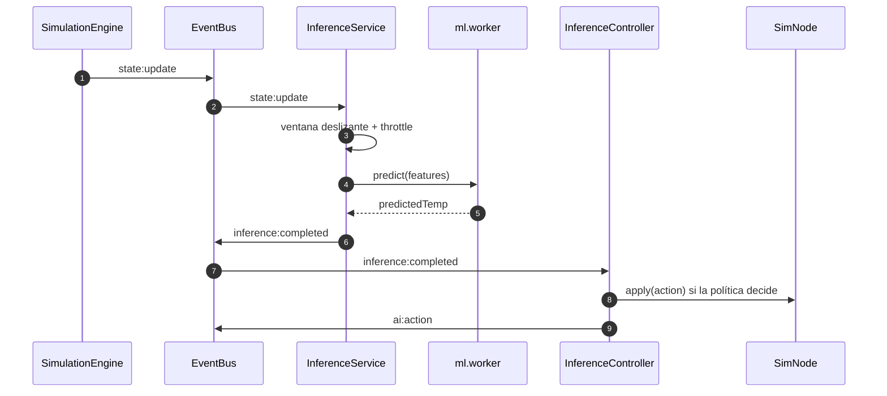

`InferenceService` guarda una ventana por nodo (`INFERENCE_WINDOW=25`). Cuando tiene `INFERENCE_MIN_SAMPLES=9`, pide predicción. Hay throttle de 500 ms por nodo y una sola inferencia en vuelo por nodo.

La auto-inferencia está activa si `INFERENCE_ENABLED=true`. El frontend consume `inference:completed` con batching de 250 ms.

### 9.2 Horizonte

El modelo predice el horizonte con el que fue entrenado (`ML_HORIZON_MS`, 15 s). El campo `horizonMs` de `POST /api/inference/predict` solo se devuelve como metadata. Cambiarlo no reentrena ni cambia el target.

### 9.3 Política de control

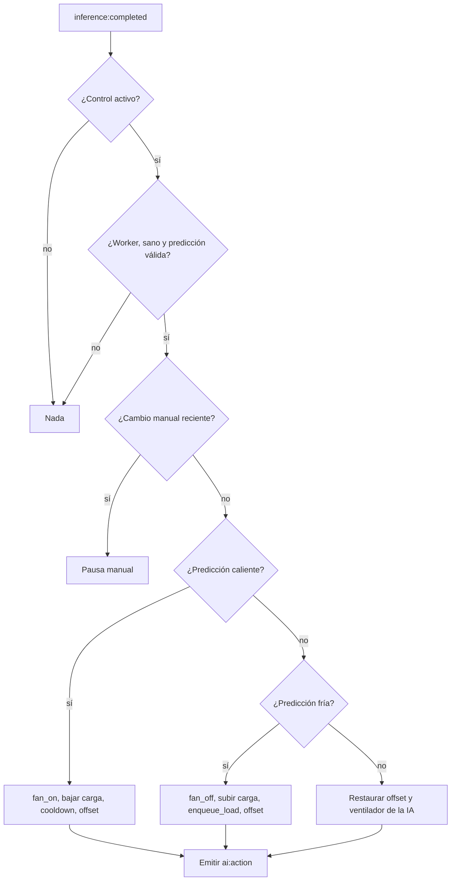

Guardarraíles:

| Regla | Valor default |
|---|---:|
| Solo workers | El general no se controla |
| Confirmaciones | 2 predicciones consecutivas |
| Cooldown por nodo | 5000 ms |
| Máximo global | 20 acciones/minuto |
| Pausa por cambio manual | 30 000 ms |
| Offset máximo | ±1.5 °C |
| Paso de offset | 0.5 °C |
| Carga | 0.05–0.8, paso 0.1 |
| Tareas | mínimo 15 s entre tareas |
| Apagado de emergencia | Desactivado |

Al desactivar el control se liberan offset, ventilador propio y apagados aplicados por la IA.

### 9.4 Limitación conocida

`InferenceService.request` no envía `taskHeat` al worker. `build_inference_features` rellena `task_heat=0` cuando falta. La inferencia en vivo no ve el calor de la tarea actual, aunque el entrenamiento sí. Si corriges esto, reentrena y valida la paridad de features.

## 10. Persistencia y base de datos

### 10.1 Qué se guarda

| Dato | Tabla | Origen |
|---|---|---|
| Temperatura y estado por nodo | `telemetry` | `node:updated` |
| Reglas disparadas | `events` (`kind=rule`) | `rule:triggered` |
| Tareas | `events` (`kind=task`) | `task:queued`, `task:completed`, `task:pending` |
| Alertas | `events` (`kind=alert`) | `alert` |
| Inferencias | `inferences` + `events` (`kind=inference`) | `inference:completed` |
| Acciones de IA | `events` (`kind=ai_action`) | `ai:action` |
| Eventos de simulación | `events` (`kind=sim_event`) | `event:triggered` |

### 10.2 Flujo del sink

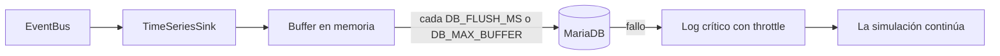

`TimeSeriesSink` escribe por lotes. Si la BD falla, registra un log crítico con throttle de 5 s y descarta el buffer pendiente. No hay reintento persistente.

`telemetry.target_temp` guarda `targetTemp + aiTargetOffset`, es decir, el objetivo efectivo. El modelo aprende con ese valor.

### 10.3 Esquema

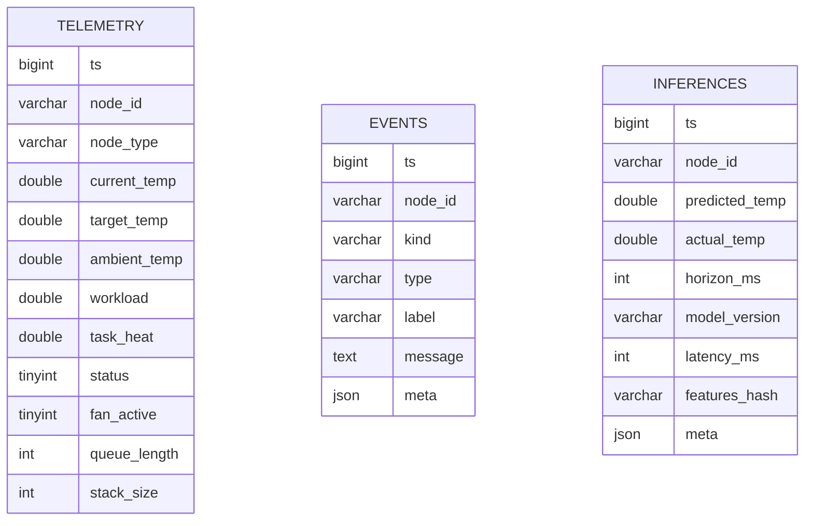

No hay claves foráneas. Son series temporales independientes.

### 10.4 Reglas de oro de la BD

- `DB_ENABLED=true` por defecto, pero la BD es opcional.
- Una BD caída no detiene la simulación.
- El DDL es idempotente: `docker/mysql/init/01-schema.sql`.
- Si añades una columna, actualiza el DDL, el sink y las features de ML.

## 11. Pipeline de ML

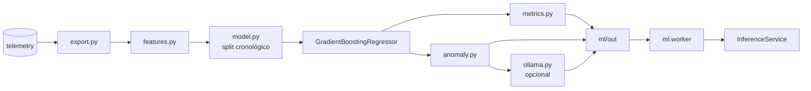

### 11.1 Features

20 features:

`temp_lag_1` … `temp_lag_8`, `temp_delta`, `temp_ma5`, `temp_std5`, `workload`, `task_heat`, `fan_active`, `status`, `queue_length`, `stack_size`, `target_temp`, `ambient_temp`, `rel_time_ms`.

El target es la temperatura `horizon_ms` en el futuro, calculada por nodo con `searchsorted`. Se descartan filas sin ventana completa o sin futuro.

### 11.2 Modelo

| Hiperparámetro | Valor |
|---|---:|
| Tipo | `GradientBoostingRegressor` |
| `n_estimators` | 120 |
| `max_depth` | 4 |
| `learning_rate` | 0.08 |
| `subsample` | 0.9 |
| `random_state` | 42 |
| Split | Cronológico por nodo, 80/20 |
| Baseline | `temp_lag_1` |

### 11.3 Métricas y la trampa de la baseline

Artefacto de referencia de la sesión S10 (4 nodos, 3892 lecturas, horizonte 15 s):

| Métrica | Valor |
|---|---:|
| MAE | 0.2306 °C |
| RMSE | 0.4025 °C |
| Baseline MAE | 0.00228 °C |
| Mejora vs baseline | negativa (~-10028 %) |

La baseline de persistencia es casi perfecta en régimen estacionario. El modelo solo aporta valor en transiciones: apagado, encendido, cooldown o picos. Con transiciones el MAE sube a ~1 °C.

No interpretes la mejora negativa como un fallo del pipeline. Es una propiedad del simulador suave.

### 11.4 Comandos

```powershell
ml\.venv\Scripts\python -m ml.train
ml\.venv\Scripts\python -m ml.train --write-db
ml\.venv\Scripts\python -m ml.train --no-ollama
ml\.venv\Scripts\python -m ml.train --since 2026-10-22T17:00:00Z
ml\.venv\Scripts\python -m ml.predict --node node-1
ml\.venv\Scripts\python -m pytest ml
```

Salidas en `ml/out/`:

- `model.joblib`
- `model.json`
- `metrics.json`
- `alerts.jsonl`

`ml/out/`, `ml/data/` y `ml/.venv/` están gitignoreados.

## 12. Frontend

React 19 con JSX, sin TypeScript. Vite hace proxy de `/api` y `/socket.io` al backend.

### 12.1 Composición

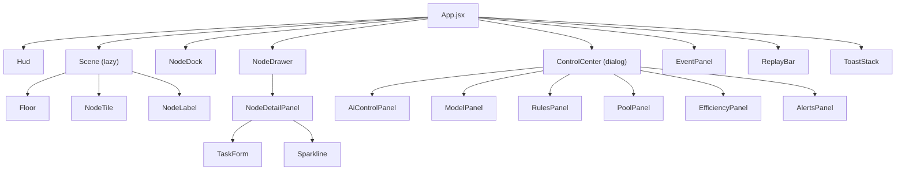

### 12.2 Hooks

| Hook | Responsabilidad |
|---|---|
| `useSimulation` | Socket singleton; `state:update` → snapshot; `alert` → alertas; API de simulación, nodos y pool |
| `useRules` | `GET /api/rules`; refresh en `rule:triggered`; toggle y delete |
| `useHistory` | Socket propio; acumula 600 snapshots; índice de replay (−1 = vivo) |
| `useInference` | `inference:completed` con batching de 250 ms; versión del modelo |
| `useAiControl` | `ai:action`; `GET/PATCH /api/ai/control` |
| `useEvents` | `event:triggered`; `GET/PATCH/POST /api/events` |
| `useTheme` | `data-theme`, `localStorage` y toggle |
| `useReducedMotion` | Respeta `prefers-reduced-motion` |

Los paquetes de Socket.IO llegan como:

```json
{ "type": "state:update", "ts": 1760000000000, "payload": { "workers": [] } }
```

Los hooks usan `packet.payload`. Si ves `undefined` en un componente, revisa si estás leyendo el paquete o el payload.

### 12.3 Flujo de una acción del usuario

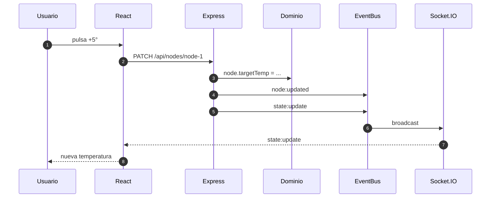

### 12.4 Replay

`useHistory` guarda hasta 600 snapshots de `state:update`. En replay, `App.jsx` usa `replaySnapshot` como fuente de verdad para la escena, el drawer y los paneles. La configuración queda deshabilitada; el panel de eventos y el drawer pasan a solo lectura. El replay es 100 % del lado del cliente.

### 12.5 Escena 3D

`three/layout.js` calcula la rejilla: workers ordenados por id en `ceil(√N)` columnas; una columna en retrato; el general va detrás. La cámara se calcula por ancho y profundidad.

`Scene` se carga con `React.lazy` y está aislada por `SceneErrorBoundary`. `main.jsx` no envuelve la app en `StrictMode`: el doble montaje desmonta el primer portal de drei `<Html>` y deja vacía la etiqueta de un nodo. No lo restaures sin resolver ese portal.

## 13. Depurar sin adivinar

### 13.1 Tabla de síntomas

| Síntoma | Primera sospecha | Dónde mirar |
|---|---|---|
| `ECONNREFUSED` en Vite | Proxy a puerto sin backend | `frontend/vite.config.js` y `PORT` |
| La UI no actualiza | Socket caído o proxy roto | Consola del navegador, `/health` |
| Una regla no dispara | Cooldown, métrica predictiva sin datos o sujeto | `GET /api/rules`, logs `rule` |
| El pool no se vacía | No hay worker activo libre | `GET /api/tasks`, estado de nodos |
| Una tarea no termina | Duración o reloj | `startedAt`, `durationSecs` |
| La IA no actúa | Desactivada, sin predicción o pausa manual | `GET /api/ai/control` |
| No hay predicciones | Falta modelo o worker Python | `GET /api/inference/version` |
| La BD está vacía | MariaDB caída o `DB_ENABLED=false` | `docker compose ps`, logs |
| El replay no edita | Es intencional | Volver a **Vivo** |

### 13.2 Árbol de decisión rápido

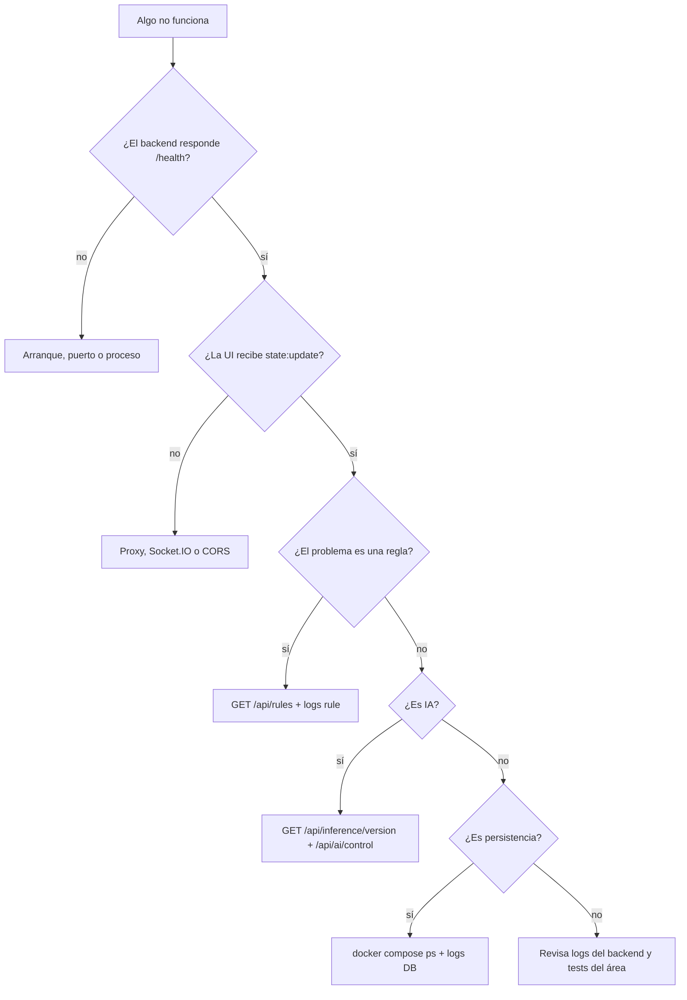

### 13.3 Los logs que importan

- `Backend WAItt escuchando...`: arranque correcto.
- `Simulación iniciada...`: el tick está activo.
- `No se pudo inicializar el esquema BD`: MariaDB o DDL.
- `Error escribiendo en la BD`: el sink no puede persistir.
- `Modelo de IA cargado (versión ...)`: worker Python listo.
- `Regla "..." disparada...`: regla evaluada y resultado.
- `Tarea completada...`: fin de una tarea.
- `Evento ...`: disparo manual o automático.

### 13.4 Trampas conocidas

- `typecheck` falla si hay locales o parámetros sin usar (`noUnusedLocals`, `noUnusedParameters`).
- No uses `z.ZodType<T>` en la validación: los `.default()` dentro de `.refine()` infieren `optional` y rompen `RuleInput`/`TaskOptions`.
- Los imports relativos del backend llevan sufijo `.js` por ESM + NodeNext.
- No añadas un tercer lockfile al frontend: ya hay `pnpm-lock.yaml` y `package-lock.json`.
- No commitees `node_modules/`, `dist/`, `ml/.venv/`, `ml/out/` ni `ml/data/`.
- No pongas comentarios en el código. El estilo del repo no los usa.

## 14. Recetas de cambio

Cada receta es un cambio completo y verificable. Empieza por la más pequeña.

### Receta 1: cambiar un parámetro térmico

**Objetivo:** que el nodo reaccione más rápido.

**Archivos:**

- `backend/src/domain/thermal.ts`
- `backend/test/thermal-calibration.test.ts`
- `backend/test/thermal.test.ts`

**Pasos:**

1. Cambia `timeConstantMs` de `20000` a `15000`.
2. Ejecuta `pnpm.cmd run test test/thermal-calibration.test.ts`.
3. Ajusta las expectativas si el cambio es intencional.
4. Ejecuta `pnpm.cmd run typecheck` y `pnpm.cmd run test`.
5. Si usas ML, reentrena con `--since` para no mezclar muestras del modelo anterior.

**Criterio de aceptación:**

- Los tests térmicos pasan.
- El equilibrio documentado sigue siendo coherente o actualizas la documentación.
- No hay `NaN` ni temperaturas fuera de rango.

### Receta 2: añadir una regla semilla

**Objetivo:** que una regla exista al arrancar.

**Archivo:** `backend/data/default-rules.json`

**Pasos:**

1. Añade un objeto con `name`, `metric`, `op`, `value`, `action` y `actionParams`.
2. Reinicia el backend.
3. Comprueba `GET /api/rules`.
4. Fuerza la condición con `PATCH /api/nodes/node-1` y observa el log.

**Criterio de aceptación:**

- La regla aparece al arrancar.
- Dispara cuando se cumple la condición.
- El cooldown evita disparos repetidos.
- `rule:triggered` incluye `applied` y, si aplica, `taskId`.

### Receta 3: añadir un tipo de tarea

**Objetivo:** permitir `backup` como tipo de tarea.

**Archivos:**

- `backend/src/domain/types.ts`: añade `'backup'` a `TaskType` y `TASK_TYPE_VALUES`.
- `backend/src/api/validation.ts`: no hace falta si usa `TASK_TYPE_VALUES`.
- `backend/test/tasks.test.ts` o `backend/test/actions.test.ts`: añade cobertura.
- `backend/README.md` y `docs/guia-usuario.md`: documenta el tipo.

**Pasos:**

1. Añade el tipo.
2. Verifica que `POST /api/tasks` lo acepta.
3. Verifica que una tarea `backup` se procesa como cualquier tarea normal.
4. Si debe enfriar, añade lógica en `node.ts`; si no, no toques el térmico.

**Criterio de aceptación:**

- `POST /api/tasks` con `{"type":"backup"}` devuelve `201`.
- La tarea se despacha y completa.
- Un tipo inválido sigue devolviendo `400`.
- Los tests pasan.

### Receta 4: añadir un evento

**Objetivo:** añadir `memory_pressure`, que sube la carga de un worker.

**Archivos:**

- `backend/src/domain/events.ts`: `EventId`, `EVENT_IDS`, `EVENT_CATALOG`, `applyEvent`.
- `backend/src/config.ts`: nueva probabilidad `EVENT_MEMORY_PRESSURE_PROBABILITY`.
- `backend/src/index.ts`: pasa la probabilidad al `EventEngine`.
- `backend/.env.example`: documenta la variable.
- `backend/src/api/events.routes.ts`: añade el id a `MUTATING_EVENTS` si muta estado.
- `backend/test/events.test.ts` y `backend/test/events-api.test.ts`: cobertura.
- `docs/guia-usuario.md` y `docs/guia-tecnica.md`: catálogo.

**Pasos:**

1. Añade el id y la definición al catálogo.
2. Implementa el efecto en `applyEvent` con `clamp`.
3. Registra la probabilidad en configuración y arranque.
4. Añade el evento a la lista de mutantes si aplica.
5. Prueba el disparo manual y el automático.

**Criterio de aceptación:**

- `GET /api/events` muestra el evento.
- `POST /api/events/memory_pressure/trigger` funciona.
- El general se rechaza con `400`.
- El evento se persiste como `kind=sim_event`.
- El generador automático lo puede disparar.

### Receta 5: exponer `taskHeat` en el drawer

**Objetivo:** que el usuario vea el calor neto de la tarea actual.

**Archivos:**

- `frontend/src/components/NodeDetailPanel.jsx`
- `frontend/src/App.css` si hace falta.

**Pasos:**

1. Añade una métrica en `detail__grid`:

```jsx
<div className="detail__metric">
  <div>calor de tarea</div>
  <div>{node.taskHeat.toFixed(2)}</div>
</div>
```

2. Comprueba que el layout sigue bien en móvil y escritorio.
3. Verifica que en replay el valor se muestra pero no se puede editar.

**Criterio de aceptación:**

- El valor aparece en el drawer.
- Un `cooldown` muestra un valor negativo.
- Un nodo inactivo muestra `0`.
- `npm.cmd run lint` y `npm.cmd test` pasan.

### Receta 6: añadir una feature de ML

**Objetivo:** que el modelo use una señal nueva.

**Archivos:**

- `docker/mysql/init/01-schema.sql`
- `backend/src/infra/timeseriesSink.ts`
- `ml/features.py`
- `ml/worker.py`
- `backend/src/infra/ai/inferenceService.ts`
- `ml/tests/test_features.py` y `ml/tests/test_worker.py`

**Pasos:**

1. Añade la columna a `telemetry`.
2. Escribe el dato en el sink.
3. Añade la feature en `build_features` y `build_inference_features`.
4. Envía el dato desde `InferenceService`.
5. Reentrena y compara MAE/RMSE.
6. Actualiza `model.json`, `metrics.json` y la documentación.

**Criterio de aceptación:**

- El pipeline entrena sin errores.
- `ml/out/model.json` lista la feature.
- El worker acepta la petición con la nueva feature.
- La inferencia en vivo no falla.
- La documentación refleja el cambio.

## 15. Ejercicios guiados

### Ejercicio 1: seguir un tick sin escribir código

**Objetivo:** entender el orden real.

1. Arranca backend y frontend.
2. Abre el drawer de `node-1`.
3. Pulsa **+5°**.
4. Observa el log del backend y el HUD.
5. Anota qué ocurre primero: ¿cambia el objetivo, la temperatura o la UI?

**Criterio de aceptación:** puedes explicar en una frase por qué la temperatura no cambia de golpe.

### Ejercicio 2: crear una regla por API

**Objetivo:** ver el ciclo completo de una regla.

1. Crea una regla `temperature > 40 → send_alert`.
2. Fuerza la temperatura de `node-1` a 45 con `PATCH /api/nodes/node-1`.
3. Espera un tick.
4. Revisa el log, la pestaña **Automatización** y la pila del nodo.
5. Reinicia el backend y comprueba que la regla desapareció.

**Criterio de aceptación:** ves `rule:triggered`, una alerta y una entrada en la pila. Explicas por qué desapareció al reiniciar.

### Ejercicio 3: cambiar la inercia térmica

**Objetivo:** hacer un cambio de física con tests.

1. Cambia `timeConstantMs` a 15 000.
2. Ejecuta los tests térmicos.
3. Ajusta las expectativas solo si el cambio es intencional.
4. Compara la curva antes y después con el drawer.

**Criterio de aceptación:** los tests pasan y puedes explicar qué constante cambiaste y por qué.

### Ejercicio 4: añadir el tipo `backup`

**Objetivo:** extender un enum sin romper la API.

1. Sigue la receta 3.
2. Encola una tarea `backup` desde `POST /api/tasks`.
3. Comprueba que se despacha al worker más frío.
4. Comprueba que un tipo inventado devuelve `400`.

**Criterio de aceptación:** el tipo nuevo funciona y la validación sigue rechazando lo inválido.

### Ejercicio 5: añadir un evento de carga

**Objetivo:** practicar el catálogo de eventos.

1. Sigue la receta 4.
2. Dispara el evento a mano sobre `node-1`.
3. Revisa `GET /api/events` y la tabla `events` si tienes BD.
4. Activa el generador y espera un disparo automático.

**Criterio de aceptación:** el evento aparece en el catálogo, muta el estado y se persiste.

### Ejercicio 6: mostrar `taskHeat`

**Objetivo:** practicar el frontend sin tocar el backend.

1. Sigue la receta 5.
2. Encola una tarea `cooldown` con demanda 5.
3. Observa el valor negativo mientras se procesa.
4. Comprueba el modo claro, oscuro y móvil.

**Criterio de aceptación:** el valor es correcto y el layout no se rompe.

### Ejercicio 7: comparar modelo y baseline

**Objetivo:** entender la métrica negativa.

1. Ejecuta `ml.train` con telemetría reciente.
2. Abre `ml/out/metrics.json`.
3. Compara `mae` con `baseline_mae`.
4. Busca un tramo con transiciones y explica por qué el modelo mejora o empeora.

**Criterio de aceptación:** puedes explicar por qué la baseline es casi perfecta en régimen estacionario.

## 16. Checklist antes de un PR

### Código

- [ ] El cambio está en la capa correcta (`domain`, `engine`, `api`, `infra`).
- [ ] No hay I/O dentro del dominio.
- [ ] No hay comentarios nuevos en el código.
- [ ] Los imports relativos del backend llevan `.js`.
- [ ] No hay locales ni parámetros sin usar.

### Verificación

```powershell
cd backend
pnpm.cmd run typecheck
pnpm.cmd run test
pnpm.cmd run build

cd ../frontend
npm.cmd test
npm.cmd run lint
npm.cmd run build

cd ..
ml\.venv\Scripts\python -m pytest ml
```

- [ ] 146 tests de backend en verde.
- [ ] 11 tests de frontend en verde.
- [ ] 18 tests de ML en verde.
- [ ] El build del frontend separa la escena en su propio chunk.
- [ ] Probaste claro/oscuro y móvil si tocaste UI.
- [ ] Probaste replay si tocaste paneles.

### Documentación

- [ ] Actualizaste la guía de usuario si cambió la UI.
- [ ] Actualizaste la guía técnica si cambió la API, la BD o la IA.
- [ ] Actualizaste `.env.example` si añadiste una variable.
- [ ] Actualizaste el catálogo de eventos o reglas si aplica.

### Git

- [ ] Commits en español, imperativo y con scope.
- [ ] Cada commit compila y pasa tests por sí solo.
- [ ] No commiteaste artefactos de build.
- [ ] No hiciste push sin pedirlo.

## 17. Para seguir aprendiendo

- [Guía de Usuario](guia-usuario.md): cómo se usa la interfaz.
- [Guía Técnica](guia-tecnica.md): arquitectura, API, BD, IA y ML.
- [Pruebas y calibración](pruebas-calibracion.md): resultados y límites.
- `backend/README.md`: API y eventos WebSocket.
- `ml/README.md`: pipeline analítico.
- `AGENTS.md`: convenciones del repositorio.

La forma más rápida de aprender WAItt es seguir un tick con el log abierto y cambiar una sola cosa a la vez. Si puedes explicar qué pasa entre `state:update` y `node:updated`, ya tienes el modelo mental.
