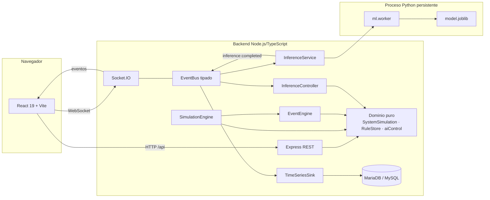
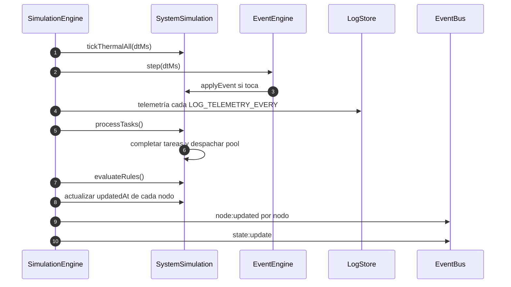
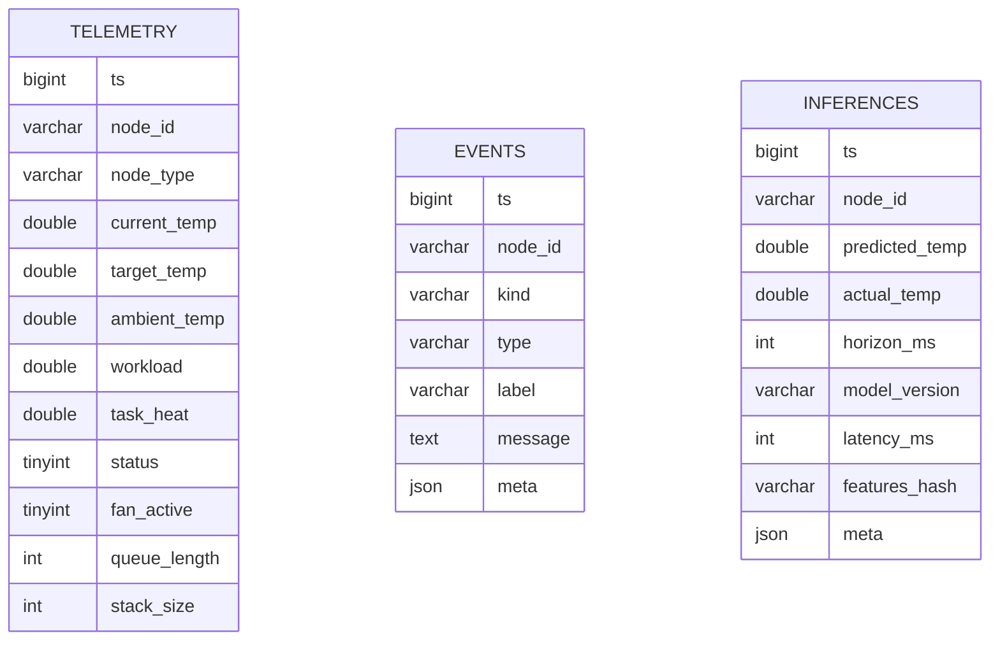
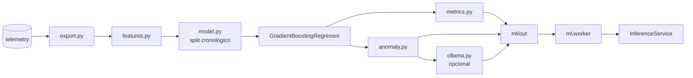
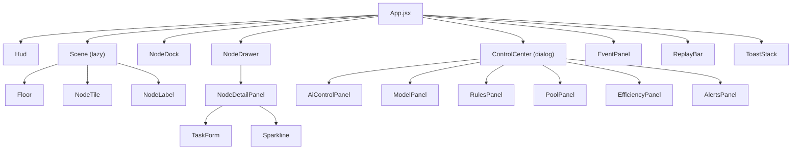

# Guía Técnica — WAItt Simulador de Temperatura

WAItt es el acrónimo del **Sistema de cuidado del agua mediante técnicas de inteligencia artificial y estrangulamiento térmico**.

Guía para desarrolladores que van a **mantener o extender** el proyecto. Presupone lectura previa de la [Guía de Usuario](guia-usuario.md), la [Guía Junior](guia-junior.md) y `AGENTS.md`.

## 1. Visión general

Tres piezas dentro del mismo repositorio:

| Pieza | Tecnología | Carpeta | Función |
|---|---|---|---|
| Backend | Node.js/TypeScript, Express + Socket.IO | `backend/` | Simulación, API REST, WebSocket, persistencia y orquestación de IA |
| Frontend | React 19 + Vite + Three.js | `frontend/` | Escaparate inmersivo, control y replay |
| Pipeline analítico | Python, pandas, scikit-learn, Ollama | `ml/` | Entrenamiento, métricas, anomalías y worker de inferencia |

No hay hardware ni firmware Arduino. El backend replica la lógica del antiguo sistema: modelo térmico, nodos con estados, colas de prioridad, pila LIFO, reglas reactivas y eventos.



### 1.1 Flujo de datos

1. El **SimulationEngine** avanza el tick y muta el dominio.
2. El dominio emite eventos al **EventBus** (`node:updated`, `state:update`, `rule:triggered`, etc.).
3. `Socket.IO` reenvía cada evento al navegador.
4. `TimeSeriesSink` acumula filas y las escribe en MariaDB.
5. `InferenceService` consume `state:update`, mantiene una ventana por nodo y pide la predicción al worker Python.
6. `InferenceController` consume `inference:completed` y aplica la política de control IA.
7. El frontend consume REST y WebSocket; el replay es 100 % del lado del cliente.

### 1.2 Contrato de puertos

El backend escucha en `PORT`. El proxy de Vite debe apuntar a ese mismo puerto; `CORS_ORIGIN` corresponde al origen del frontend, no al puerto del backend.

| Pieza | Dónde se configura | Default |
|---|---|---|
| Backend | `PORT` en `backend/.env` | `3000` |
| Proxy Vite | `frontend/vite.config.js` | `http://localhost:3000` |
| CORS | `CORS_ORIGIN` en `backend/.env` | `http://localhost:5173` |
| Frontend | Vite | `5173` |

Regla: con los valores por defecto, backend y proxy usan `3000` y el frontend se abre en `5173`. Si cambias `PORT`, cambia también los targets de `/api` y `/socket.io` en `vite.config.js`; si no, Vite devuelve `ECONNREFUSED`. Si cambias el puerto del frontend, actualiza `CORS_ORIGIN`.

## 2. Estructura del repositorio

```text
backend/
  src/
    api/          routers Express + validación zod + AppContext
    config/       configuración de base de datos
    domain/       lógica pura sin I/O
    engine/       EventBus, SimulationEngine, EventEngine
    infra/        HTTP, Socket.IO, logs, persistencia, BD, IA
  data/           default-rules.json (semilla de reglas)
  test/           146 tests vitest
frontend/
  src/
    components/   HUD, escena, dock, drawer, centro de control, eventos
    hooks/        conexión REST/WS y estado del cliente
    lib/          recomendación
    three/        escena Three.js, layout, tema y etiquetas
  src/**/*.test.js  11 tests node:test
ml/
  export.py       lectura de telemetría
  features.py     features y target
  model.py        split y GradientBoostingRegressor
  metrics.py      MAE/RMSE y baseline
  anomaly.py      umbral de residuos
  ollama.py       explicación opcional
  train.py        orquestador
  predict.py      inferencia puntual
  worker.py       worker JSON stdin/stdout
  tests/          18 tests pytest
docker/
  mysql/init/01-schema.sql   DDL idempotente
docs/
  guia-tecnica.md
  guia-usuario.md
  guia-junior.md
  pruebas-calibracion.md
```

Capas del backend:

| Capa | Responsabilidad | No debe hacer |
|---|---|---|
| `domain/` | Modelo térmico, nodos, tareas, reglas, acciones, eventos, política IA | I/O, HTTP, BD |
| `engine/` | Orquestar el tick, emitir eventos, evaluar reglas y eventos | Conocer Express o MariaDB |
| `api/` | Validar entrada, traducir a dominio, responder HTTP | Implementar física o reglas |
| `infra/` | HTTP, Socket.IO, logs, persistencia, BD, worker Python | Decidir reglas de negocio |

## 3. Modelo de dominio

### 3.1 Nodo (`domain/node.ts`)

Cada nodo es el **Servidor General** (`node-general`, agregado) o un **worker** (`node-1..N`).

| Campo | Tipo | Significado |
|---|---|---|
| `id` | string | `node-general` o `node-<id>` |
| `name` | string | Nombre visible |
| `type` | `general` / `worker` | El general no se controla ni admite perturbaciones |
| `status` | `active` / `inactive` / `error` | Estado simulado |
| `currentTemp` | number | Temperatura actual (°C) |
| `targetTemp` | number | Objetivo base del usuario |
| `aiTargetOffset` | number | Offset temporal aplicado por la IA (máx. ±1.5 °C) |
| `ambientTemp` | number | Temperatura ambiente |
| `workload` | 0–1 | Carga de trabajo |
| `taskHeat` | number | Calor neto de la tarea actual; negativo para `cooldown` |
| `fanActive` | boolean | Ventilador |
| `fanUntilMs` | number | Expiración del ventilador (`0` = manual) |
| `stats` | objeto | Fallos, fallos consecutivos, máximo, `ok` |
| `queue` | `QueueDto` | Cola local de prioridad |
| `stack` | `StackDto` | Pila LIFO de eventos |
| `updatedAt` | number | Última actualización |

Modelo térmico (`domain/thermal.ts`):

| Parámetro | Valor | Efecto |
|---|---:|---|
| `timeConstantMs` | 20 000 | Inercia hacia el objetivo |
| `loadHeatGain` | 0.35 | Calor por unidad de `workload` |
| `dissipationRate` | 0.002 | Disipación hacia el ambiente |
| `fanDissipationMultiplier` | 3 | Multiplicador del ventilador |
| `COMPUTE_DEMAND_HEAT` | 0.07 | Calor por unidad de `computeDemand` |
| `COOLDOWN_TASK_COOLING` | 0.07 | Enfriamiento por unidad en tareas `cooldown` |
| `INACTIVE_COOLING_TIME_MS` | 60 000 | Constante de enfriamiento de un nodo inactivo |

Fórmula activa:

```text
temp += ((target - temp) / 20 + 0.35 * workload + taskHeat
         - 0.002 * (temp - ambient) * fanMultiplier) * dt
```

Con `workload=0` el equilibrio queda cerca de 29.62 °C para target 30 °C. Con `workload=0.3`, cerca de 31.63 °C. El objetivo no es el punto de equilibrio exacto: la carga y la disipación lo desplazan. Es una propiedad del modelo, no un fallo.

Un nodo inactivo disipa hacia el ambiente con constante de 60 s. Las tareas `cooldown` restan calor. El ventilador expira solo si `fanUntilMs > 0`.

### 3.2 Tarea, cola y pool

Tipos: `cooldown`, `maintenance`, `reboot`, `calibration`, `custom`.

| Campo | Rango | Default | Efecto |
|---|---:|---:|---|
| `priority` | 1–5 | 3 | 5 es la más urgente; empate FIFO |
| `computeDemand` | 1–5 | 1 | Calor extra `demanda × 0.07` |
| `durationSecs` | 1–10 | 5 | Duración canónica |
| `description` | 120 chars | — | Texto libre |
| `payload` | objeto | — | Datos de la tarea |

Estados: `pending`, `processing`, `completed`.

Hay dos destinos:

1. **Cola local del nodo** (`node.enqueueTask`): capacidad `NODE_QUEUE_CAPACITY` (50).
2. **Pool global** (`system.submitPending`): capacidad `PENDING_POOL_CAPACITY` (100).

Cada tick, `dispatchHighestPriority` asigna la tarea de mayor prioridad del pool al **worker activo libre más frío** (cola local vacía y sin tarea en curso). Después, cada nodo arranca su propia cola local. Cada nodo procesa una tarea a la vez.

El dispatcher no asigna al general. El general puede procesar tareas encoladas por API o por reglas con `subject=system`, pero no recibe del pool.

### 3.3 Pila LIFO (`domain/stack.ts`)

Cada nodo tiene una pila de eventos con capacidad `STACK_CAPACITY` (20). Guarda entradas `event`, `task`, `rule`, `alert` y `change`. La última entrada es la más reciente. Se muestra en el drawer y en la etiqueta 3D.

### 3.4 Reglas (`domain/rules.ts`)

Una regla tiene:

| Campo | Valores |
|---|---|
| `subject` | `any`, `all`, `system`, `node` |
| `metric` | `temperature`, `temperatureDelta`, `predictedTemperature`, `predictedDelta`, `workload`, `status`, `queueLength`, `stackLength` |
| `op` | `>`, `>=`, `<`, `<=`, `==`, `!=` |
| `action` | `fan_on`, `fan_off`, `shutdown`, `startup`, `enqueue_task`, `send_alert`, `reduce_load`, `set_workload`, `set_target_temperature` |
| `cooldownMs` | 0–3 600 000, default 30 000 |
| `actionParams` | objeto libre |

Semántica:

- `any`: dispara si **algún** worker cumple. La acción se aplica a cada worker que cumple.
- `all`: dispara solo si **todos** los workers cumplen. La acción se aplica a los que cumplen.
- `system`: actúa sobre el nodo general.
- `node`: actúa sobre `nodeId`.

`predictedTemperature` y `predictedDelta` usan la última inferencia del nodo. La predicción vale **60 s** (`PREDICTION_TTL_MS`). Sin predicción fresca o con `NaN`, la regla no dispara. `predictedDelta = predicha − targetTemp` base, sin `aiTargetOffset`.

Si `action=enqueue_task` y `subject=any|all`, se inyecta **una** tarea al pool global, no una por nodo. `runAction` devuelve `{applied, reason?, taskId?}`; `rule:triggered` incluye ese resultado.

Las reglas se leen cada tick con `rules.enabledList()`: se pueden crear, editar, activar o eliminar en caliente por API. La semilla `RULES_FILE` es de solo lectura; las mutaciones viven en memoria y se pierden al reiniciar.

### 3.5 Eventos de simulación (`domain/events.ts`)

Catálogo de primera clase. Cada evento tiene `id`, nombre, categoría, probabilidad, cooldown, `enabled` y parámetros.

| Id | Categoría | Prob. default | Cooldown | Efecto |
|---|---|---:|---:|---|
| `task_arrival` | tráfico | 0.08 | 3 s | Encola 1–3 tareas en el pool o en la cola de un nodo |
| `thermal_spike` | perturbación | 0.02 | 15 s | Suma `magnitude` (6 °C) a un worker |
| `node_failure` | perturbación | 0.01 | 60 s | Fuerza `error` sin cancelar la tarea actual |
| `node_recovery` | perturbación | 0.03 | 30 s | Devuelve a `active` y limpia fallos |
| `fan_failure` | perturbación | 0.01 | 30 s | Apaga el ventilador de un worker |
| `workload_surge` | perturbación | 0.02 | 30 s | Suma `magnitude` (0.35) de carga, tope 1 |
| `synthetic_alert` | perturbación | 0.01 | 30 s | Emite una alerta sin cambiar la temperatura |

Reglas de aplicación:

- El disparo manual (`POST /api/events/:id/trigger`) salta probabilidad y cooldown.
- El disparo automático solo elige workers elegibles; nunca el general.
- Las perturbaciones que mutan estado (`thermal_spike`, `node_failure`, `node_recovery`, `fan_failure`, `workload_surge`) rechazan el nodo general con 400 si se piden por API.
- `task_arrival` con `nodeId` encola en la cola local; sin `nodeId`, en el pool.
- Cada disparo emite `event:triggered`, se registra con tipo `event` y se persiste como `kind=sim_event`.
- `EVENTS_ENABLED=false` por defecto: el generador arranca apagado. El catálogo no se persiste; reiniciar restablece los valores.

### 3.6 Política de control IA (`domain/aiControl.ts`)

Acciones: `fan_on`, `fan_off`, `set_workload`, `target_offset`, `enqueue_cooldown`, `enqueue_load`, `shutdown`, `startup`.

Guardarraíles:

- Solo workers. El general es un agregado.
- Nodo en `error`: no se toca.
- Predicción inválida: no se actúa.
- Cambio manual de objetivo, ventilador o carga: pausa `AI_CONTROL_MANUAL_PAUSE_MS` (30 s).
- Confirmaciones: `AI_CONTROL_CONFIRMATIONS` (2) predicciones consecutivas.
- Cooldown por nodo: `AI_CONTROL_COOLDOWN_MS` (5 s).
- Límite global: `AI_CONTROL_MAX_ACTIONS_PER_MIN` (20).
- Carga: paso 0.1, mínimo 0.05, máximo 0.8.
- Offset de objetivo: máximo ±1.5 °C, paso 0.5 °C.
- Tareas: mínimo 15 s entre tareas y cola local por debajo del 50 %.
- Apagado de emergencia: desactivado por defecto (`AI_CONTROL_ALLOW_SHUTDOWN=false`).
- Al desactivar el control se liberan offset, ventilador propio y apagados de la IA.

## 4. Motor de simulación

### 4.1 Tick

`SimulationEngine` usa `Date.now()` y un delta real acotado a `MAX_DT_MS = 5000`. No usa un `dt` fijo por `TICK_MS`.

Orden exacto de `step(dtMs)`:



Por qué importa el orden:

- Los eventos se aplican **después** del térmico y **antes** de las tareas. Un `task_arrival` puede despacharse en el mismo tick.
- Las reglas se evalúan **después** de procesar tareas, así ven el estado más reciente.
- `state:update` se emite al final, una vez por tick, con el snapshot completo.
- `node:updated` se emite por cada nodo antes del snapshot; `TimeSeriesSink` lo usa para telemetría.

`stepOnce(dtMs)` existe para tests: ejecuta un tick sin depender del reloj.

### 4.2 Reglas en caliente

`evaluateRules()` recorre `rules.enabledList()` cada tick. No hay caché de reglas. El `RuleStore` es la única fuente y la API muta el mismo objeto en memoria. Esto permite editar reglas sin reiniciar, pero también implica que un reinicio restablece la semilla.

### 4.3 Generador de eventos

`EventEngine.step(dtMs)` acumula `dtMs` y evalúa cuando alcanza `EVENTS_INTERVAL_MS`. Si el generador está apagado, no acumula. Por cada evento:

1. ¿Está `enabled`?
2. ¿Pasó su `cooldownMs` desde `lastTriggeredAt`?
3. ¿`rng() < probability`?

Si las tres se cumplen, dispara con `source=auto`. El RNG y el reloj son inyectables para tests.

## 5. API REST

Prefijo `/api`. Errores de validación → `400 {error, issues}`; recurso inexistente → `404`; cola o pool lleno → `409`; inferencia deshabilitada → `503`; fallo del worker → `502`.

### 5.1 `/health`

| Método | Ruta | Respuesta |
|---|---|---|
| GET | `/health` | `{status:'ok', running, tickMs, uptimeMs}` |

### 5.2 `/api/nodes`

| Método | Ruta | Body | Respuesta |
|---|---|---|---|
| GET | `/` | — | `{nodes: NodeDto[]}` (general + workers) |
| GET | `/:id` | — | `{node}` o 404 |
| POST | `/` | `{name, initialTemp?, targetTemp?, ambientTemp?, workload?}` | 201 `{node}` |
| PATCH | `/:id` | `{name?, status?, targetTemp?, ambientTemp?, workload?, fanActive?, fanMinutes?}` | `{node}` |
| DELETE | `/:id` | — | 204 (400 si es el general) |
| GET | `/:id/queue` | — | `{queue: QueueDto}` |
| POST | `/:id/queue` | `{type?='custom', priority?=3, computeDemand?=1, durationSecs?=5, description?, payload?}` | 201 `{task}` o 409 |
| DELETE | `/:id/queue` | — | `{removed: n}` |
| GET | `/:id/stack` | — | `{stack: StackDto}` |

`QueueDto`: `{list, size, capacity, remaining, processing}`.

### 5.3 `/api/tasks`

Pool global de tareas pendientes.

| Método | Ruta | Body | Respuesta |
|---|---|---|---|
| GET | `/` | — | `{pending: PendingQueueDto}` |
| POST | `/` | `{type?='custom', priority?=3, computeDemand?=1, durationSecs?=5, description?, payload?}` | 201 `{task}` o 409 |
| DELETE | `/` | — | `{removed: n}` |

`PendingQueueDto`: `{list, size, capacity, remaining}`.

### 5.4 `/api/system`

| Método | Ruta | Body | Respuesta |
|---|---|---|---|
| GET | `/` | — | `{system: SystemSnapshotDto}` |
| PATCH | `/` | `{targetTemp?, ambientTemp?, running?}` | `{system}` |

`SystemSnapshotDto`: `{ts, running, targetTemp, ambientTemp, general, workers[], summary{totalWorkers, activeWorkers, inactiveWorkers, errorWorkers, averageTemp}, pendingQueue{list, size, capacity, remaining}}`.

### 5.5 `/api/rules`

| Método | Ruta | Body | Respuesta |
|---|---|---|---|
| GET | `/` | — | `{rules: Rule[]}` |
| POST | `/` | `RuleInput` | 201 `{rule}` |
| PATCH | `/:id` | `Partial<RuleInput>` | `{rule}` o 404 |
| DELETE | `/:id` | — | 204 o 404 |

`RuleInput` se valida con `ruleSchema` en `api/validation.ts`. `nodeId` es obligatorio si `subject=node`.

Ejemplo:

```bash
curl -X POST http://localhost:3000/api/rules -H "Content-Type: application/json" \
  -d '{"name":"Ventilador","metric":"temperature","op":">","value":55,"action":"fan_on","actionParams":{"minutes":2}}'
```

### 5.6 `/api/logs`

| Método | Ruta | Query | Respuesta |
|---|---|---|---|
| GET | `/` | `level=info,warning,critical&type=system\|api\|rule\|task\|node\|ai\|alert\|event&nodeId=&since=<ms>&limit=` | `{logs, size, returned}` |
| DELETE | `/` | — | 204 |

### 5.7 `/api/sim`

| Método | Ruta | Respuesta |
|---|---|---|
| GET | `/status` | `{running, tickMs, uptimeMs, nodesCount, rulesCount, logsCount, pendingTasks}` |
| POST | `/pause` | `{running:false}` |
| POST | `/resume` | `{running:true}` |
| POST | `/tick` | `{ok:true, tickMs}` o 409 si está corriendo |
| POST | `/reset` | `{ok:true}` |

### 5.8 `/api/inference`

| Método | Ruta | Body | Respuesta |
|---|---|---|---|
| POST | `/predict` | `{nodeId}` o `{nodes:[...]}`, `horizonMs?` | Ver abajo |
| GET | `/version` | — | `{version, meta}` |

`POST /predict` con `nodeId` devuelve `{ok:true, nodeId, predictedTemp, actualTemp, horizonMs, modelVersion, latencyMs, featuresHash, at}`. Con `nodes` devuelve `{count, results}` con el estado por nodo.

Códigos: 404 si el nodo no existe, 409 si la ventana es insuficiente, 502 si la inferencia falla, 503 si `INFERENCE_ENABLED=false`.

`horizonMs` solo se devuelve como metadata. El modelo predice el horizonte con el que fue entrenado (`ML_HORIZON_MS`, 15 s). Cambiar `horizonMs` en la petición no reentrena ni cambia el target.

La `version` es `sha256(model.joblib)[:12]` con prefijo `sha256:` (o `model_version`/`version`/`git_sha` si existen en `model.json`).

### 5.9 `/api/ai`

| Método | Ruta | Body | Respuesta |
|---|---|---|---|
| GET | `/control` | — | `{available, enabled, policy, stats, nodes, recent}` |
| PATCH | `/control` | `{enabled?, policy?}` | Estado actualizado; 503 si no hay inferencia |

`available:false` si no hay inferencia. `policy` acepta los mismos campos que `AI_CONTROL_*` en camelCase (`hotDelta`, `coldDelta`, `confirmations`, `allowFan`, etc.).

### 5.10 `/api/events`

| Método | Ruta | Body | Respuesta |
|---|---|---|---|
| GET | `/` | — | `{generator:{enabled, intervalMs}, events: EventRuntimeState[], recent: EventTriggeredPayload[]}` |
| PATCH | `/` | `{enabled?, intervalMs?}` | Estado completo |
| PATCH | `/:id` | `{enabled?, probability?, cooldownMs?}` | `{event}` o 404 |
| POST | `/:id/trigger` | `{nodeId?, params?}` | `{event: EventTriggeredPayload}` |

`EventRuntimeState`: `{id, name, category, description, enabled, probability, cooldownMs, defaultParams, lastTriggeredAt?, triggerCount}`.

`POST /:id/trigger` salta probabilidad y cooldown. Si se pasa `nodeId`, debe existir. Las perturbaciones que mutan estado rechazan el general con 400. `synthetic_alert` acepta `params.message` y `params.level`.

Ejemplos:

```bash
curl http://localhost:3000/api/events
curl -X PATCH http://localhost:3000/api/events -H "Content-Type: application/json" \
  -d '{"enabled":true,"intervalMs":5000}'
curl -X POST http://localhost:3000/api/events/thermal_spike/trigger \
  -H "Content-Type: application/json" -d '{"nodeId":"node-1","params":{"magnitude":4}}'
```

## 6. Eventos Socket.IO

`infra/sockets.ts` reenvía cada evento del bus como paquete `{type, ts, payload}` con el nombre del evento. El cliente se conecta con `io()` a través del proxy de Vite.

| Evento | Payload | Cuándo se emite |
|---|---|---|
| `state:update` | `SystemSnapshotDto` | Cada tick y tras pausa/resume/reset/PATCH |
| `node:updated` | `{nodeId, node}` | Cada tick y tras cambios por API o IA |
| `rule:triggered` | `{rule, nodeId?, action, applied, reason?, taskId?, predictedTemp?, at}` | Regla disparada; `nodeId` falta si la tarea fue al pool |
| `task:queued` | `{nodeId, task}` | Tarea encolada por API, regla o evento |
| `task:completed` | `{nodeId, task}` | Tarea terminada |
| `task:pending` | `{task}` | Tarea al pool global |
| `alert` | `{level:'warning'\|'critical', message, nodeId?, at}` | Acción `send_alert` o alerta sintética |
| `inference:completed` | `{nodeId, predictedTemp, actualTemp, horizonMs, modelVersion, latencyMs, featuresHash?, at}` | Inferencia automática o por API |
| `ai:action` | `{nodeId, action, params?, reason, predictedTemp, actualTemp, baseTarget, targetTemp, offset, applied, at}` | Política IA aplicada |
| `event:triggered` | `{eventId, name, category, source, nodeId?, applied, message, taskIds?, params?, at}` | Evento de simulación disparado |

Los eventos se emiten con `io.emit(...)` (broadcast global). Existen salas `node:<id>` y los mensajes `node:subscribe` / `node:unsubscribe`, pero los eventos actuales no filtran por sala.

El frontend agrupa `inference:completed` cada 250 ms para no re-renderizar por cada nodo. `state:update` alimenta el snapshot y el historial de replay.

## 7. Persistencia y base de datos

### 7.1 Log

`infra/logger.ts` mantiene un buffer de `LOG_CAPACITY` (200) y lo vuelca a `LOG_FILE` en JSONL. Al arrancar restaura el buffer ignorando líneas corruptas. `DELETE /api/logs` vacía buffer y archivo. `LOG_CONSOLE`, `LOG_LEVEL`, `LOG_HTTP` y `LOG_TELEMETRY_EVERY` controlan la salida.

### 7.2 Reglas

`infra/rulesLoader.ts` carga `RULES_FILE` al arrancar. Es una semilla de solo lectura: crear, editar o eliminar por API vive solo en memoria. Reiniciar restablece las 7 reglas originales.

### 7.3 Capa `Database`

`infra/database.ts` envuelve `mysql2/promise` con una API estilo PDO:

| Método | Descripción |
|---|---|
| `query<T>(sql, params)` | Consulta cruda por el pool |
| `execute<T>(sql, params)` | Statement preparado; acepta `?` o `:nombre` |
| `insert(table, row)` | `INSERT` desde una fila-objeto |
| `insertMany(table, rows)` | `INSERT` multi-fila |
| `transaction<T>(work)` | `BEGIN`/`COMMIT`/`ROLLBACK` sobre una conexión |
| `ensureSchema(file)` | Ejecuta el DDL una vez, idempotente |
| `close()` | Cierra el pool |

Los identificadores de tabla y columna se validan con `/^[A-Za-z_][A-Za-z0-9_]*$/`. El driver es inyectable para tests.

`config/database.ts` traduce `DB_*` a la configuración del pool. `index.ts` abre la conexión y la inyecta en `TimeSeriesSink`.

### 7.4 Esquema time-series

DDL único: `docker/mysql/init/01-schema.sql`.



No hay claves foráneas: las tablas son series temporales independientes. La vista `telemetry_minute` resume por minuto.

### 7.5 `TimeSeriesSink`

Se suscribe al bus y acumula filas:

| Evento | Destino |
|---|---|
| `node:updated` | `telemetry` |
| `rule:triggered` | `events` (`kind=rule`, `type=rule`) |
| `task:queued` / `task:completed` / `task:pending` | `events` (`kind=task`, `type=task`) |
| `alert` | `events` (`kind=alert`, `type=alert`) |
| `inference:completed` | `inferences` + `events` (`kind=inference`) |
| `ai:action` | `events` (`kind=ai_action`, `type=ai`) |
| `event:triggered` | `events` (`kind=sim_event`, `type=event`) |

Escribe por lotes cada `DB_FLUSH_MS` (1000 ms) o al llegar a `DB_MAX_BUFFER` (1000 filas). Si la BD falla, registra un log crítico con throttle de 5 s y la simulación continúa. El buffer pendiente se descarta; no hay reintento persistente.

`telemetry.target_temp` guarda `targetTemp + aiTargetOffset`, es decir, el objetivo efectivo. El modelo aprende con ese valor.

## 8. Pipeline analítico (`ml/`)

Pipeline reproducible que lee `telemetry` y produce modelo, métricas y alertas.



| Paso | Módulo | Salida |
|---|---|---|
| Conexión pymysql con placeholders `:nombre` | `db.py` | — |
| Lectura de `telemetry` | `export.py` | DataFrame + CSV |
| Features | `features.py` | `X`, `y`, `meta` |
| Target a `ML_HORIZON_MS` futura con `searchsorted` | `features.py` | serie objetivo |
| Split cronológico 80/20 por nodo | `model.py` | posiciones train/test |
| Entrenamiento | `model.py` | modelo + baseline `temp_lag_1` |
| MAE/RMSE global y por nodo | `metrics.py` | `metrics.json` |
| Umbral `media + N·σ` de residuos de test | `anomaly.py` | `alerts.jsonl` |
| Explicación Ollama top-K | `ollama.py` | `meta.ollama` |
| Orquestación y `--write-db` | `train.py` | `out/*` + `events` |

### 8.1 Features (20)

`temp_lag_1` … `temp_lag_8`, `temp_delta`, `temp_ma5`, `temp_std5`, `workload`, `task_heat`, `fan_active`, `status`, `queue_length`, `stack_size`, `target_temp`, `ambient_temp`, `rel_time_ms`.

El target es la temperatura `horizon_ms` en el futuro, calculada por nodo con `searchsorted`. Se descartan las filas sin ventana completa o sin futuro.

### 8.2 Modelo

`GradientBoostingRegressor` con:

| Hiperparámetro | Valor |
|---|---:|
| `n_estimators` | 120 |
| `max_depth` | 4 |
| `learning_rate` | 0.08 |
| `subsample` | 0.9 |
| `random_state` | `ML_SEED` (42) |

Baseline: `temp_lag_1` (persistencia). El split es cronológico por nodo, 80/20. No se mezcla tiempo entre train y test.

### 8.3 Métricas y límites

En el artefacto de referencia de la sesión S10 (4 nodos, 3892 lecturas, horizonte 15 s):

| Métrica | Valor |
|---|---:|
| MAE | 0.2306 °C |
| RMSE | 0.4025 °C |
| Baseline MAE | 0.00228 °C |
| Mejora vs baseline | negativa (~-10028 %) |

La baseline de persistencia es casi perfecta en régimen estacionario. El modelo solo aporta valor en transiciones (apagado, encendido, cooldown, picos). Con transiciones el MAE sube a ~1 °C. No interpretes la mejora negativa como un fallo del pipeline: es una propiedad del simulador suave.

Umbral de anomalías: `media + N·σ` de los residuos absolutos **de test**. Con `ML_THRESHOLD_SIGMA=3` los datos nominales no generan alertas. Con `1.0` se ve el flujo completo.

### 8.4 Artefactos y comandos

`ml/out/` y `ml/data/` están gitignoreados.

```powershell
ml\.venv\Scripts\python -m ml.train
ml\.venv\Scripts\python -m ml.train --write-db
ml\.venv\Scripts\python -m ml.train --no-ollama
ml\.venv\Scripts\python -m ml.train --since 2026-10-22T17:00:00Z
ml\.venv\Scripts\python -m ml.predict --node node-1
ml\.venv\Scripts\python -m pytest ml
```

Salidas: `model.joblib`, `model.json`, `metrics.json`, `alerts.jsonl`, `ml/data/telemetry.csv`.

Tras cambiar la física térmica, reentrena con `--since` para no mezclar muestras del modelo anterior.

## 9. Inferencia en vivo

### 9.1 Worker Python

`infra/ai/inferenceWorker.ts` lanza un proceso persistente:

```text
python -m ml.worker
```

Habla JSON por stdin/stdout, una petición por línea. Comandos: `ping`, `version`, `predict`. Cada petición lleva `id`; la respuesta lo repite. Timeout por petición: `INFERENCE_TIMEOUT_MS` (2000 ms), con margen extra para `version()` por el cold start. Si el proceso cae, la siguiente petición lo reinicia de forma perezosa. `rejectAll` rechaza las peticiones en vuelo al salir.

`ml/worker.py` carga `model.joblib` y `model.json`, calcula la versión y reconstruye features con `build_inference_features` (sin target). Ancla `rel_time_ms` a un origen por nodo.

### 9.2 Servicio

`InferenceService` se suscribe a `state:update`:

1. Guarda una muestra por nodo en una ventana deslizante (`INFERENCE_WINDOW=25`).
2. Cuando hay `INFERENCE_MIN_SAMPLES=9`, lanza inferencia.
3. Throttle por nodo: `INFERENCE_THROTTLE_MS=500`.
4. Una sola inferencia en vuelo por nodo.
5. Emite `inference:completed`.

La auto-inferencia está siempre activa si `INFERENCE_ENABLED=true`. El frontend consume el evento y `GET /api/inference/version`.

Limitación conocida: `InferenceService.request` no envía `taskHeat` al worker. `build_inference_features` rellena `task_heat` con 0 cuando falta. La inferencia en vivo no ve el calor de la tarea actual aunque el entrenamiento sí. Si corriges esto, reentrena y valida la paridad de features.

### 9.3 Arranque y parada

`index.ts` hace `inference.start()` (suscripción) → `inferenceWorker.start()` (spawn) → log de versión. En el shutdown: `engine.stop()` → `aiControl.stop()` → `inference.stop()` → `sink.close()` → `database.close()` → `persistence.save()`.

## 10. Control IA

`InferenceController` consume `inference:completed`, detecta cambios manuales y llama a `decideAiAction`.

### 10.1 Decisión

| Situación | Acción |
|---|---|
| General, error, predicción inválida o pausa manual | Ninguna |
| Nodo inactivo apagado por IA, frío y con downtime | `startup` |
| Caliente (`predicha > base + hotDelta`) | `shutdown` de emergencia, `fan_on`, `set_workload` abajo, `enqueue_cooldown`, `target_offset` abajo |
| Frío (`predicha < base - coldDelta`) | `fan_off` si el ventilador es de la IA, `set_workload` arriba, `target_offset` arriba, `enqueue_load` |
| En banda | `fan_off` de la IA y restauración del offset |

El objetivo efectivo es `targetTemp + aiTargetOffset`. El objetivo del usuario no se modifica.

### 10.2 Aplicación

`apply()` reutiliza `runAction` para ventilador, carga y tareas. Para `target_offset` escribe `node.aiTargetOffset` y deja una entrada `change` en la pila. Cada acción aplicada emite `ai:action`, `node:updated` y un log tipo `ai`.

`release()` al desactivar: offset a 0, ventilador propio apagado, nodos apagados por IA reactivados, contadores a cero. Si cambió algo, emite `node:updated`.

### 10.3 Persistencia

`ai:action` se guarda en `events` con `kind=ai_action` y `type=ai`. El `meta` incluye predicción, temperatura real, objetivo base, objetivo efectivo, offset y parámetros.

## 11. Frontend

React 19 (JSX sin TypeScript) + Vite. El proxy de Vite envía `/api` y `/socket.io` al backend.



### 11.1 Hooks

| Hook | Responsabilidad |
|---|---|
| `useSimulation` | Socket singleton; `state:update` → snapshot; `alert` → alertas (máx. 20); API REST de simulación, nodos y pool |
| `useRules` | `GET /api/rules`; refresh en `rule:triggered`; toggle y delete |
| `useHistory` | Socket propio; acumula `MAX_SAMPLES=600` snapshots; índice de replay (−1 = vivo) |
| `useInference` | `inference:completed` con batching de 250 ms; versión y metadatos del modelo |
| `useAiControl` | `ai:action`; `GET/PATCH /api/ai/control`; estado y feed |
| `useEvents` | `event:triggered`; `GET/PATCH/POST /api/events`; generador y catálogo |
| `useTheme` | `data-theme` en `<html>`, `localStorage` (`waitt-theme`) y toggle |
| `useReducedMotion` | Respeta `prefers-reduced-motion` |

### 11.2 UI

- **HUD flotante**: marca, estado de conexión, media, activos, errores, botón IA, objetivo global, tema, pausa/reanudar, alertas y acceso al centro de control.
- **Escena 3D cenital**: cada nodo es un rack de servidor. La altura, el panel frontal, el LED y el halo codifican temperatura. Inactivo gris, error rojo con pulso, ventilador con disco cian.
- **Dock de nodos**: lista navegable con flechas, Home y End.
- **Drawer**: detalle del nodo, objetivo ±5°, ventilador, métricas, predicción, cola, pila, formulario de tarea y sparkline.
- **Centro de control** (`<dialog>`): pestañas **IA** (predicciones + control), **Automatización** (reglas + pool), **Sistema** (eficiencia + reset) y **Alertas**.
- **Panel de eventos**: botón flotante con icono `joker`; activa el generador, ajusta intervalo, probabilidad y cooldown, dispara eventos y muestra el feed reciente. En replay es solo lectura.
- **ReplayBar**: línea de tiempo, reproducción automática (600 ms), paso a paso y vuelta a vivo.
- **Toasts**: alertas recientes, máximo 3 visibles, 6 s.
- **Tema**: claro/oscuro; el script pre-paint de `index.html` evita el destello.

### 11.3 Escena 3D

`three/layout.js` calcula la rejilla: workers ordenados por id en `ceil(√N)` columnas; una columna en retrato; el general va detrás. La cámara se calcula por ancho/profundidad. `three/theme.js` define la paleta y se pasa por props a `Scene`, `Floor` y `NodeTile`.

`Scene` se carga con `React.lazy` y está aislada por `SceneErrorBoundary`. `main.jsx` no envuelve la app en `StrictMode`: el doble montaje desmonta el primer portal de drei `<Html>` y deja vacía la etiqueta de un nodo.

### 11.4 Replay

`useHistory` guarda hasta 600 snapshots de `state:update`. En replay, `App.jsx` usa `replaySnapshot` como fuente de verdad para la escena, el drawer y los paneles. La configuración queda deshabilitada; el panel de eventos y el drawer pasan a solo lectura. El replay es 100 % client-side.

## 12. Variables de entorno

Definidas en `backend/src/config.ts` (zod con defaults). Ejemplo en `backend/.env.example`.

### 12.1 Generales

| Variable | Default | Efecto |
|---|---|---|
| `PORT` | `3000` | Puerto HTTP + WebSocket |
| `TICK_MS` | `1000` | Intervalo del tick (50–60 000 ms) |
| `INITIAL_NODES` | `3` | Workers iniciales (1–200) |
| `INITIAL_TEMP` | `25` | Temperatura inicial |
| `TARGET_TEMP` | `30` | Objetivo global inicial |
| `AMBIENT_TEMP` | `20` | Ambiente global inicial |
| `CORS_ORIGIN` | `http://localhost:5173` | Origen permitido |
| `NODE_QUEUE_CAPACITY` | `50` | Cola local por nodo |
| `STACK_CAPACITY` | `20` | Pila LIFO |
| `PENDING_POOL_CAPACITY` | `100` | Pool global |
| `LOG_CAPACITY` | `200` | Buffer de logs |
| `LOG_FILE` | `data/logs.jsonl` | Archivo JSONL (`""` desactiva) |
| `LOG_CONSOLE` | `true` | Logs en consola |
| `LOG_LEVEL` | `info` | Nivel mínimo en consola |
| `LOG_HTTP` | `true` | Log de cada petición HTTP |
| `LOG_TELEMETRY_EVERY` | `5` | Línea de telemetría cada N ticks; `0` desactiva |
| `MAX_CONSECUTIVE_FAILURES` | `5` | Fallos para estado `error` |
| `RULES_FILE` | `data/default-rules.json` | Semilla de reglas |

### 12.2 Base de datos

| Variable | Default | Efecto |
|---|---|---|
| `DB_ENABLED` | `true` | Activa el sink time-series |
| `DB_HOST` | `localhost` | Host (`db` dentro de Docker Compose) |
| `DB_PORT` | `3306` | Puerto |
| `DB_NAME` | `waitt` | Base de datos |
| `DB_USER` | `waitt` | Usuario |
| `DB_PASSWORD` | `waitt` | Contraseña |
| `DB_FLUSH_MS` | `1000` | Intervalo de vaciado |
| `DB_MAX_BUFFER` | `1000` | Filas antes de forzar vaciado |
| `DB_SCHEMA_FILE` | `../docker/mysql/init/01-schema.sql` | DDL idempotente |

### 12.3 Inferencia

| Variable | Default | Efecto |
|---|---|---|
| `INFERENCE_ENABLED` | `true` | Lanza el worker Python y la auto-inferencia |
| `INFERENCE_HORIZON_MS` | `15000` | Horizonte con el que se entrenó y se predice |
| `INFERENCE_THROTTLE_MS` | `500` | Mínimo entre inferencias por nodo |
| `INFERENCE_TIMEOUT_MS` | `2000` | Timeout por petición |
| `INFERENCE_MIN_SAMPLES` | `9` | Muestras mínimas de la ventana |
| `INFERENCE_WINDOW` | `25` | Tamaño de la ventana deslizante |
| `INFERENCE_PYTHON` | `ml/.venv/Scripts/python.exe` | Intérprete del worker |

### 12.4 Control IA

| Variable | Default | Efecto |
|---|---|---|
| `AI_CONTROL_ENABLED` | `false` | Arranca con control activo |
| `AI_CONTROL_HOT_DELTA` / `COLD_DELTA` | `1.5` | Banda de disparo (°C) |
| `AI_CONTROL_RESTORE_DELTA` | `0.5` | Banda de restauración |
| `AI_CONTROL_CONFIRMATIONS` | `2` | Predicciones consecutivas |
| `AI_CONTROL_COOLDOWN_MS` | `5000` | Espera entre acciones del nodo |
| `AI_CONTROL_MAX_ACTIONS_PER_MIN` | `20` | Límite global |
| `AI_CONTROL_LOAD_STEP` / `MIN` / `MAX` | `0.1` / `0.05` / `0.8` | Rango y paso de carga |
| `AI_CONTROL_TARGET_MARGIN` / `STEP` | `1.5` / `0.5` | Offset máximo y paso |
| `AI_CONTROL_TASK_INTERVAL_MS` | `15000` | Mínimo entre tareas de la IA |
| `AI_CONTROL_EMERGENCY_DELTA` | `10` | Diferencia para apagado de emergencia |
| `AI_CONTROL_RESTART_DELTA` | `2` | Umbral de reactivación |
| `AI_CONTROL_MIN_DOWNTIME_MS` | `30000` | Downtime mínimo |
| `AI_CONTROL_MANUAL_PAUSE_MS` | `30000` | Pausa por cambio manual |
| `AI_CONTROL_ALLOW_FAN/LOAD/TARGET/TASKS` | `true` | Acciones permitidas |
| `AI_CONTROL_ALLOW_SHUTDOWN` | `false` | Apagado de emergencia |

### 12.5 Eventos

| Variable | Default | Efecto |
|---|---|---|
| `EVENTS_ENABLED` | `false` | Generador automático |
| `EVENTS_INTERVAL_MS` | `5000` | Intervalo de evaluación |
| `EVENT_TASK_ARRIVAL_PROBABILITY` | `0.08` | Probabilidad de tráfico |
| `EVENT_THERMAL_SPIKE_PROBABILITY` | `0.02` | Probabilidad de pico térmico |
| `EVENT_NODE_FAILURE_PROBABILITY` | `0.01` | Probabilidad de fallo |
| `EVENT_NODE_RECOVERY_PROBABILITY` | `0.03` | Probabilidad de recuperación |
| `EVENT_FAN_FAILURE_PROBABILITY` | `0.01` | Probabilidad de fallo de ventilador |
| `EVENT_WORKLOAD_SURGE_PROBABILITY` | `0.02` | Probabilidad de pico de carga |
| `EVENT_SYNTHETIC_ALERT_PROBABILITY` | `0.01` | Probabilidad de alerta sintética |

## 13. Cómo extender el proyecto

### 13.1 Agregar un tipo de acción

1. Añade el nombre a `ActionType` y `ACTION_TYPE_VALUES` en `domain/types.ts`.
2. Añade un `case` en `runAction` (`domain/actions.ts`) con `numParam`/`strParam`.
3. Añade tests en `test/rules.test.ts` y, si aplica, en `test/ai-control.test.ts`.
4. Si la IA debe usarla, añade el `AiActionKind` y la decisión en `domain/aiControl.ts`.

### 13.2 Agregar un campo a un nodo

1. `NodeConfig` y `SimNode` en `domain/node.ts`.
2. `NodeDto` y `toDto()` en `domain/types.ts` / `node.ts`.
3. Si es editable: `patchNodeSchema` o `createNodeSchema` en `api/validation.ts` y `nodes.routes.ts`.
4. Si afecta al térmico: `thermalStep` o `thermal.ts`.
5. Si afecta a la BD: columna en `docker/mysql/init/01-schema.sql`, `TimeSeriesSink` y `ml/features.py`.
6. Reentrena el modelo si cambia la física o las features.

### 13.3 Agregar una regla por defecto

Añade un objeto válido en `backend/data/default-rules.json`. `rulesLoader` filtra por `isRuleInput` (requiere `name`, `metric`, `op`, `value`, `action`). Reinicia para recargar la semilla.

### 13.4 Agregar un evento

1. Añade el id a `EventId` y `EVENT_IDS` en `domain/events.ts`.
2. Añade la definición a `EVENT_CATALOG`.
3. Implementa el efecto en `applyEvent`.
4. Si muta estado, añade el id a `MUTATING_EVENTS` en `api/events.routes.ts`.
5. Añade la variable `EVENT_*_PROBABILITY` en `config.ts`, `index.ts` y `.env.example`.
6. Añade tests en `test/events.test.ts` y, si aplica, en `test/events-api.test.ts`.
7. Documenta el evento en la guía de usuario y en la junior.

### 13.5 Agregar una acción de IA

1. Añade el `AiActionKind` en `domain/aiControl.ts`.
2. Añade la decisión en `decideAiAction`.
3. Añade el `case` en `InferenceController.apply`.
4. Añade el flag `AI_CONTROL_ALLOW_*` si debe poder desactivarse.
5. Añade tests en `test/ai-control.test.ts` e `test/inference.test.ts`.

### 13.6 Agregar una feature ML

1. Añade la columna a `telemetry` y a `TimeSeriesSink`.
2. Añade la feature en `ml/features.py` (`build_features` y `build_inference_features`).
3. Añade el dato a `InferenceService` y al mapeo de `ml/worker.py`.
4. Reentrena y compara MAE/RMSE.
5. Actualiza `model.json`/`metrics.json` y la documentación.

### 13.7 Agregar una tabla o columna

1. Edita `docker/mysql/init/01-schema.sql` (idempotente).
2. Añade el mapeo en `TimeSeriesSink`.
3. Añade el método en `Database` si hace falta.
4. Añade tests con el driver falso.
5. Documenta la consulta de ejemplo.

### 13.8 Agregar un panel de UI

1. Crea el componente en `frontend/src/components/`.
2. Añade el hook o la API que necesite.
3. Añade la pestaña en `ControlCenter.jsx` o el panel flotante en `App.jsx`.
4. Respeta `readOnly` en replay y `disabled` cuando no haya conexión.
5. Añade estilos en `App.css` y prueba claro/oscuro y móvil.

## 14. Verificación y git

Antes de commitear:

```powershell
cd backend
pnpm.cmd run typecheck
pnpm.cmd run test
pnpm.cmd run build

cd ../frontend
npm.cmd test
npm.cmd run lint
npm.cmd run build

cd ..
ml\.venv\Scripts\python -m pytest ml
```

- `typecheck` falla con locals/parámetros sin usar (`noUnusedLocals`/`noUnusedParameters`).
- 146 tests vitest en `backend/test/`.
- 11 tests `node:test` en frontend.
- 18 tests pytest en `ml/tests/`.
- `npm.cmd run build` debe separar la escena en su propio chunk; el aviso de chunk grande es esperado por Three.js.

Commits en español, imperativo, con scope: `feat:`, `fix:`, `docs:`, `chore:`, `test:`. No commitear artefactos de build (`node_modules/`, `dist/`, `ml/.venv/`, `ml/out/`, `ml/data/`).

## 15. Troubleshooting técnico

### `ECONNREFUSED` en Vite

El proxy apunta a un puerto donde no hay backend. Compara:

```text
PORT del backend == target de /api y /socket.io en vite.config.js
```

Con los valores por defecto, el proxy queda así:

```js
'/api': 'http://localhost:3000',
'/socket.io': { target: 'http://localhost:3000', ws: true },
```

Si cambias `PORT` a propósito, usa ese mismo valor en ambos targets.

### CORS

`CORS_ORIGIN` debe ser el origen exacto del frontend (`http://localhost:5173`). No uses `*` con credenciales.

### `EADDRINUSE`

Otro proceso ocupa el puerto. En PowerShell:

```powershell
Get-NetTCPConnection -LocalPort 3000 -State Listen
```

Cierra el proceso o cambia `PORT` y el proxy.

### La BD no responde

El backend sigue simulado. Busca `No se pudo inicializar el esquema BD` o `Error escribiendo en la BD` en el log. Levanta MariaDB:

```powershell
docker compose up -d
```

### Inferencia 503 o sin predicciones

- `INFERENCE_ENABLED=false`: no hay worker.
- No existe `ml/out/model.joblib`: entrena con `python -m ml.train`.
- `INFERENCE_PYTHON` no apunta al intérprete correcto.
- El worker murió: el servicio lo reinicia en la siguiente petición.
- Ventana insuficiente: espera `INFERENCE_MIN_SAMPLES` ticks.

### El generador de eventos no hace nada

`EVENTS_ENABLED=false` por defecto. Actívalo por API o por el panel. Revisa también `enabled`, `probability` y `cooldownMs` de cada evento.

### El replay no permite editar

Es intencional. En replay, `App.jsx` usa `replaySnapshot` y el centro de control, el drawer y el panel de eventos pasan a solo lectura. Vuelve a vivo para editar.

### Las reglas nuevas desaparecen al reiniciar

`RULES_FILE` es una semilla de solo lectura. Las mutaciones por API viven en memoria. Para persistirlas, añádelas al archivo semilla o implementa persistencia de reglas.
